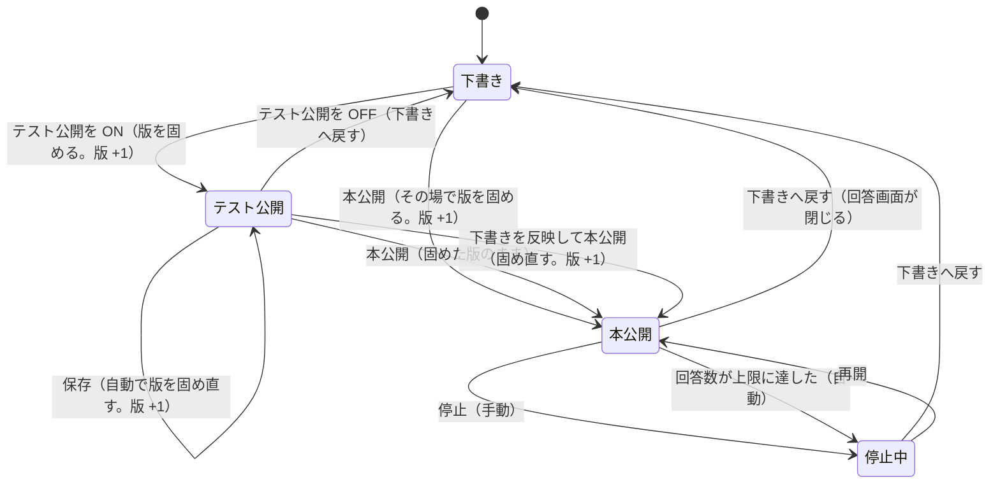
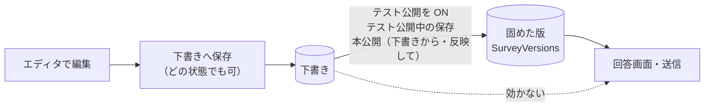
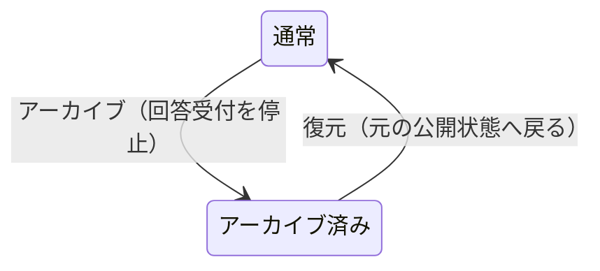

# アンケート公開状態フロー

アンケートの公開状態と、編集・公開・停止・アーカイブの関係。
**「編集したのに回答画面へ効かない」を防ぐための、状態ごとの動きの一覧。**
操作の画面設計は [`画面設計.md`](画面設計.md)、列の定義は [`データモデル設計.md`](データモデル設計.md)。

> 根拠は 2026-10-10 時点のソース。Issue #1057（2026-11-24）で公開の流れを整理した（行番号は関数名へ置き換えた）。
> 画面は実機で確かめていない。

## 1. 要点

- **公開は「下書き → 本公開」の 2 ステップ**（Issue #1057）。**本公開は下書きからも、テスト公開中からも押せる。**
  下書きから押すと、その場で版を固めて（版 +1）本公開する
- **テスト公開は段階ではなく、下書きに付けるチェック。** ON の間は、下書きのまま公開 URL が付く
  （「テスト公開中」と常に表示・テスト回答は別集計）。OFF にすると下書きへ戻る
- **編集は常に「下書き」へ保存される。** 回答画面が読むのは、公開時に固めた**版（スナップショット）**だけ。
  ただし**テスト公開が ON の間の保存は、同時に版を固め直す（保存のたびに版 +1）。** URL で見える内容＝最後に保存した内容
- **版は不変。** 本公開中・停止中の編集を回答画面へ効かせるには、下書きへ戻して固め直す
- **テスト公開中から本公開するときは、固めた版をそのまま使う**（「下書きを反映して本公開」を選ぶと、固め直してから本公開する）
- **アーカイブは公開状態とは別軸。** どの状態にも重なる

## 2. 状態

| 状態 | 値 | 回答画面 | 回答が読む版 |
| --- | --- | --- | --- |
| 下書き（`Draft`） | 0 | 開けない | なし（`PublishedVersion` が空、または前回の版） |
| 本公開（`Published`） | 1 | 開ける | 固めた版 |
| 停止中（`Suspended`） | 2 | 受け付けない | 固めた版 |
| テスト公開（`TestPublished`） | 3 | 開ける（**「テスト公開中」と常に表示**） | 固めた版 |

停止中の理由は `SuspendedReason` に残る（`Manual` = 手で停止 / `ResponseLimitReached` = 回答数上限で自動停止）。

## 3. 状態遷移

| 操作 | 画面の場所 | API | 元の状態 | 先の状態 | 版 |
| --- | --- | --- | --- | --- | --- |
| テスト公開を ON | 一覧・エディタ（チェック） | `POST /{id}/test-publish` | 下書きだけ | テスト公開 | **+1** |
| テスト公開中の保存 | エディタ | `PUT /{id}`（**保存と同時に版を固め直す**。下の注） | テスト公開 | テスト公開 | **+1（保存のたび）** |
| （API）テスト公開に反映する | — | `POST /{id}/test-republish`（下書きへ戻さない。後方互換で残す） | テスト公開 | テスト公開 | **+1** |
| テスト公開を OFF／下書きへ戻す | 一覧・エディタ | `POST /{id}/revert-to-draft` | テスト公開・本公開・停止中 | 下書き（停止の理由は消す） | 変わらない |
| 本公開（下書きから） | 一覧・エディタ（主操作） | `POST /{id}/publish` | 下書き | 本公開 | **+1**（その場で固める） |
| 本公開（固めた版のまま） | 一覧・エディタ | `POST /{id}/publish`（本文なし、または `reflectDraft: false`） | テスト公開 | 本公開 | **変わらない** |
| 下書きを反映して本公開 | 一覧・エディタ | `POST /{id}/publish` の本文 `{"reflectDraft": true}` | テスト公開 | 本公開 | **+1** |
| 停止 | 一覧 | `POST /{id}/suspend` | 本公開だけ | 停止中（`Manual`） | 変わらない |
| 再開 | 一覧 | `POST /{id}/resume` | 停止中だけ | 本公開 | 変わらない |

- **元の状態が違えばサーバは `InvalidSurveyStatus` で断る。**
  画面は、押せる操作だけを出す（エディタ・一覧: 下書きとテスト公開中は「本公開」とテスト公開のチェック、
  本公開・停止中は「下書きへ戻す」）
- **版を固める入口（テスト公開・本公開・テスト公開中の保存）は、同じ公開前の検査（`PublishInspector`・割り当て・
  ルックアップ）を通る。** 通らなければ断り、状態も版も変えない
- **固めるときは、検証を通ってから版を固める**（Issue #1008）。
  割り当ての誤りなどで拒否されても、版の衝突で失敗しても、状態は元のまま変わらない
- **テスト公開中の保存は、保存と版固めを 1 つの操作として扱う**（Issue #1057）。
    - 検査を**保存の前に**、保存しようとしている内容へ掛ける。**通らなければ保存もしない**（400）。
      下書きと版が食い違わない。不備のある編集を保存したいときは、テスト公開を OFF にする
    - 保存は通ったが、版を固める段で失敗した（同時の公開など）ときは、200 で `reflected: false` を返す。
      保存済みの下書きは残り、状態はテスト公開のまま。画面は「下書きの変更が版に未反映」と出し、次の保存でやり直せる
    - **版を固めるのは、公開の権限を持つ呼び出しだけ**（キーなら `surveys.publish` のスコープ）。
      権限が無い呼び出し（編集者・`surveys.write` だけのキー）の保存は、従来どおり下書きへ保存するだけ
    - **保存のたびに版が +1 になる。** `SurveyVersions` は保存の回数だけ増える。件数の扱いは 4 章
- **固めた版と下書きが食い違う**のは、テスト公開中に、公開の権限が無い呼び出しが保存したとき・版を固める段で失敗したときなど。
  画面は「下書きの変更が版に未反映」と出し、本公開で **「下書きを反映して本公開する」**（既定でオン）を選べる。
  オフにすると、固めた版のまま本公開する（下書きの変更は版に入らない）
- **再開は上限に達したままでは断る。** 再開しても最初の回答で再び自動停止するだけなので、先に上限を上げる
- **テンプレートには状態が無い。** 公開も停止もできない

## 4. 編集はどこへ効くか

- 下書きの保存は、アーカイブ済み以外のどの状態でも通る。**テスト公開中を除き、通っても固めた版には効かない**
  （テスト公開中は、保存が自動で版を固め直す）
- そのため、本公開中・停止中のエディタには「編集は下書きに保存されるだけで、公開中の版には反映されない」と常に表示する
- **版は保存のたびに増える（テスト公開中）。** `SurveyVersions` の行は固めるたびに 1 行増え、「過去の版」の一覧にも出る。
  **版は不変で自動では消さない**（削除の仕組みは無い）。テスト公開のまま保存を重ねる長い編集では版が多くなるので、
  編集は下書き（チェック OFF）で進め、確かめたいときに ON にする運用を勧める。1 行は定義と割り当ての JSON 1 件ぶん
- **本公開中・停止中からも「下書きへ戻す」で直せる**（Issue #542）。
  戻すと**回答画面は閉じる**（下書きは受け付けないため）。固めた版は消えず、
  直して再度テスト公開 → 本公開すると次の版ができる。画面は確認を挟む
- **過去の版を、下書きの編集へ読み込める**（Issue #544。下書きのときのエディタの「過去の版」）。
    - `GET /{id}/versions`（一覧）と `GET /{id}/versions/{version}`（中身）は**読むだけ**で、版は書き換えない
    - 読み込むのは**編集中の画面の状態だけ。保存するまで下書きは変わらない**。保存してテスト公開すると次の版になる
    - **版番号は今の下書きのもの（次に固める版）を残す。** 過去の版の番号を持ち込むと、固める版が重なる
    - 本公開中・停止中・テスト公開中は読み込めない（下書きへ戻してから）。**版が保存のたびに増えるので、一覧は長くなり得る**
- **編集の undo / redo は無い。** エディタの保護は、未保存の変更があるときの離脱確認と、
  保存の競合検出（`revision`）だけ

## 5. 状態ごとに変えられるもの

| 項目 | 下書き | テスト公開 | 本公開・停止中 |
| --- | --- | --- | --- |
| 下書きの保存 | 可 | 可（版には効かない） | 可（版には効かない） |
| Pleasanter サイト ID の変更 | 可（本番の回答が無いとき） | 可（同左） | **不可** |
| 回答の受付 | しない | する（**テスト回答として別集計**） | 本公開のみする |

- **サイト ID の変更は、送信待ちがあればサーバが拒否する**（どのサイトへ送るかが決まらないため）
- **本番の回答が 1 件でもあれば、下書きへ戻した後でも変更できない。**
  回答の対応表が旧サイトのレコードを指したままになり、次の編集が新サイトの別のレコードを更新するため
- **テスト回答は回答数上限と滞留監視から外す。** Pleasanter 側のレコードは、
  `Administrator`・`SurveyAdministrator` が一覧の「テスト回答を削除」で消せる（Issue #1010。[`画面設計.md`](画面設計.md)）。
  消せない役割は運用側へ頼む

## 6. アーカイブ（別軸）

- アーカイブ済みは、保存・テスト公開・本公開・停止・再開のすべてを断る
- 回答画面では、存在しない公開 ID と同じ画面にする（実在を推測させない）
- 完全削除はアーカイブ済みだけ。`Administrator` が題名を入力して行う

## 7. 根拠

| 内容 | 場所 |
| --- | --- |
| テスト公開は下書きだけ・版を固める共通処理 | `AdminSurveyEndpoints.cs`（`FreezeAndPublishAsync`・`ValidateForFreezeAsync`・`CommitFreezeAsync`） |
| 本公開は下書き・テスト公開から。下書きと「反映して本公開」は版を固める（`FreezeAndPublishAsync`） | `AdminSurveyEndpoints.cs`（`PublishAsync`） |
| テスト公開中の保存が版を固め直す（保存の前に検査） | `AdminSurveyEndpoints.cs`（`SaveDraftCoreAsync`） |
| 下書きへ戻すはテスト公開だけ | `AdminSurveyEndpoints.cs:1190`（判定は 1208） |
| 停止・再開と、上限到達時の再開拒否 | `AdminSurveyEndpoints.cs:1586` |
| 回答数上限による自動停止 | `SurveySnapshotStore.cs:457` |
| サイト ID の変更は下書き・テスト公開だけ | `SurveySnapshotStore.cs:507` |
| 下書きの保存はアーカイブ済み以外で通る | `AdminSurveyEndpoints.cs:563` |
| 下書きの取得応答に `status` を含める | `SurveyDraftStore.cs`（`SurveyDraft.Status`） |
