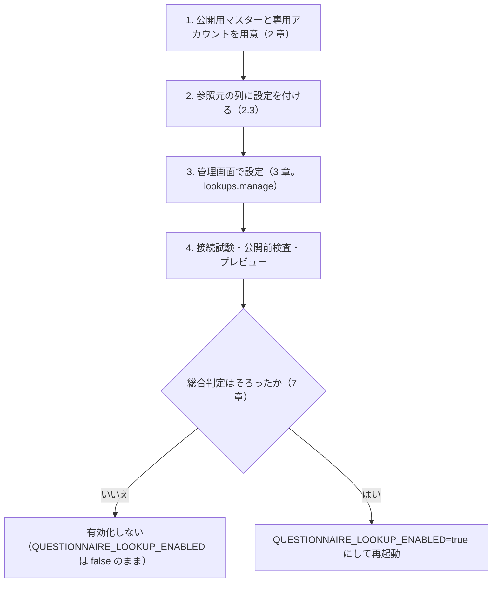

# ルックアップ項目-運用手順書

Issue #873（親 #804 の手順 7）。ルックアップ項目を導入・運用する人向けの手順。
仕様の原本は [ルックアップ項目の仕様書](ルックアップ項目の仕様書.md)、実機での検証の手順は
[ルックアップ実機確認-運用手順書](ルックアップ実機確認-運用手順書.md)、実測の結果は
[実機検証結果](実機検証結果.md) 12〜15 章。

> **現状（2026-11-06）: 有効化してはならない。** サーバー全体の有効化スイッチ（既定は無効）を入れた
> （`QUESTIONNAIRE_LOOKUP_ENABLED`。Issue #883）。手順書 5 章・P11・P12・スイッチ・HTTPS の接続先は実機で確認した
> （[実機検証結果](実機検証結果.md) 14・15 章）が、**必須の未実施（回答の下書き・送信・編集の通し、アクセシビリティ・多言語・サブパスなど。15.6）が残り、総合判定はそろっていない。**
> この文書の手順のうち、実機で確かめていないものは「**未確認**」と書く。「未確認」が残る間は、本番で有効にしない。

関連文書:
[導入-更新運用手順書](導入-更新運用手順書.md) /
[設定パラメータ一覧](設定パラメータ一覧.md) /
[アンケート作成-運用手順書](アンケート作成-運用手順書.md) /
[非機能設計](非機能設計.md)。

## 1. 全体の流れ

## 2. 参照元（Pleasanter）を用意する

### 2.1 公開用マスターは「サイトを読める人に全レコードが見える」前提で用意する

- **専用の公開用マスターサイトを別に作る。** 業務のサイトを直接参照元にしない。
- **匿名の回答者がキーを知れば取得できる機能であり、キーは本人認証ではない。**
  公開してはならない情報を、推測しにくいキーと本アプリのレート制限だけで守らない。
  **公開用マスターには、キーを知る回答者へ見せてよいレコードだけを入れる。**
- **Pleasanter には、サイトを読める人から個別のレコードだけを隠す機能がない**（2026-11-06 実測。
  サイトの Read を持つ専用アカウントに対し、管理者だけのレコード権限を足してもそのレコードは隠れない。
  [実機検証結果 13 章](実機検証結果.md) A02）。したがって**レコード単位の権限で出し分けることを前提にしない。**
  出してよい集合は、サイトの単位で分ける。
- サイト統合・権限の継承で参照範囲が広がる構成は対象外。公開前検査で拒否される
  （統合: `SourceSiteIntegrated`、継承: `SourceSiteInheritsPermission`）。継承は解除して使う
  （解除の画面操作は**未確認**。実測は DB を書き換えて再現した）。
- 専用アカウントには**そのサイトだけの読み取り**を付与する。作成・更新・削除・サイト管理は付けない
  （書き込みは 403 になることを実測した）。**回答保存用の API キーを流用しない。**
  画面での権限付与の操作は**未確認**（実測は DB への直接投入）。

### 2.2 表記ゆれのない参照元にする

完全一致の意味は、参照元の DB の照合順序に従う（Pleasanter の挙動のまま受け入れる。決定は実機検証結果 12.4 の判断 1）。
SQL Server は大文字小文字・全角半角を区別せず、PostgreSQL は全部区別する。MySQL は大文字小文字と末尾空白を区別せず、全角半角を区別する
（[実機検証結果 13.2](実機検証結果.md)）。**キーの表記が揃ったマスターにする**（例: 郵便番号は全角ハイフンや空白を含めない）。

### 2.3 参照元の列には設定を付ける

**Pleasanter の `GetSite` は、設定を付けた列だけを返す。** 設定のない標準の列（`Title`・`Body`・`Class` / `Num` / `Date` /
`Description` / `Check` の `A`〜`Z`）は列の一覧に出ない。本アプリは、そうした標準の列を、選択肢・`Nullable` のない
既定の列として補う（Issue #881）。補った列は実際の設定と違う可能性があるので、**キー列・入力元列・表示列に使う列には、
参照元のサイトの設定（列の設定）を付けておく。**

- **キー列は、選択肢のない文字列列と、整数だけの数値列に限る**（選択肢のある列・日付・チェックは初期対象外）。
- **返却を許可する数値列は `Nullable: true` にする。** 0 は既定で空として保存・返却されるため。確認できない列は公開前検査で拒否される
  （`NumberColumnNotNullable`）。
- 数値列の小数の桁数は設定が返ったときだけ分かる。返らない数値列は整数キーに使えない。
- **補った標準の列（上の既定の列）は、設定が無くても検索できた**（実機・本アプリ経由。`ClassD`・`ClassF` で確認。[実機検証結果 14.3.1](実機検証結果.md)）。
  見出し・選択肢・`Nullable` が取れるのは設定のある列だけなので、**参照元の列には設定を付ける**。
- **数値列は、小数点以下の桁数（`DecimalPlaces`）を設定する。** 設定が無い数値列は、保存時に整数へ丸められた（`2.5` が `3.0000`。
  [実機検証結果 15.3](実機検証結果.md)）。

### 2.4 参照元が満たすべき上限

参照元の Pleasanter の `Api.json` の `PageSize`（実効上限）が、本アプリが求める件数（最大候補件数 + 1。K+1）に足りない設定は、
有効化を拒否する（超過を検出できないため）。実測では、実効上限は要求の `PageSize` ではなく `Api.json` の値で切り詰められ、
応答の `TotalCount` で K+1 を検出できた（[実機検証結果 13.2](実機検証結果.md) P09）。

## 3. 管理画面で設定する

### 3.1 権限 `lookups.manage`

ルックアップの定義の変更・専用 API キー・接続試験は、**権限 `lookups.manage`（アンケート管理者と特権管理者）**だけが行える。
編集者がルックアップを変えて下書きを保存すると 403 になる。権限が無ければ編集画面は読み取り専用になる。
プレビュー検索は編集権限（`surveys.write`）で使える。権限の一覧は `Web/Services/AdminPermissions.cs`。

### 3.2 設定の手順

1. アンケート編集画面の「ルックアップ」タブで、起点・キー（N=1〜5）と参照元キー列、前方一致の許可、
   入力元列と入力先項目（M=1〜10）、モーダルの表示列、最大候補件数（既定 10・上限 20）を設定する。
2. **専用 API キーを登録する**（3.3）。入力欄は送信後に空になり、再表示・コピーはできない。
3. 「接続を確認」で、接続・読み取り権限・統合/継承の有無・列を確認する。結果は分類と列の名前・種類だけが出る。
4. 保存し、テスト公開の前に公開前検査を確認する。プレビューで 0 件・1 件・複数件を確かめる
   （**読み取り専用でも、プレビューとテスト公開は参照元の実データへアクセスする**）。
5. 管理画面の警告「キーを知る回答者が取得できるデータだけを許可してください」を必ず読む。許可列は、入力元列と表示列の和集合から自動で作られる。
6. 複製・テンプレートでは資格情報の参照を引き継がない。**複製したアンケートでは API キーを再登録する。**

### 3.3 専用 API キーの更新・失効・再開・解除

資格情報は 1 アンケートに属し、`CredentialId` で定義から参照される。公開済みの版には資格情報の平文も暗号文も入らない。
そのため、**キーの更新・失効は再公開なしで実行時に効く。**

| 目的 | 操作（管理画面の秘密 UI。API は `/api/admin/surveys/{surveyId}/lookups/credentials`） | 効き方 |
| --- | --- | --- |
| キーを更新する（ローテーション） | 参照元で新しいキーを発行し、「入れ替え」で登録する（`PUT .../{credentialId}`） | 次の検索から新しいキー。公開済みの版は書き換えない。古いキーは参照元で無効にする |
| 一時的に止める（失効） | 「失効」（`PUT .../{credentialId}/enabled` に `false`） | 直ちに検索は 502（`CredentialDisabled`）。管理者へ通知（5 章）。回答者には共通の取得失敗 |
| 再開する | 「再開」（同 `true`） | 次の検索から使える |
| 取り除く | 「解除」（`DELETE`） | 定義が参照する資格情報が無くなる。公開前検査は `CredentialNotFound` で拒否。公開済みの版の検索は 502（`CredentialMissing`） |

- **漏えいが疑われるとき**: まず本アプリで「失効」し、次に**参照元の Pleasanter でそのキーを無効にする**。
  新しいキーを発行して登録（入れ替え）し、「再開」する。
- 秘密は `QUESTIONNAIRE_SECRET_KEY` で暗号化して保存する。**この鍵を失うと、登録済みの専用 API キーは復号できない**
  （検索は 502 `CredentialUndecryptable`）。鍵を変えたら、専用 API キーをすべて再登録する。
- ログ・監査・応答にキー値・取得値・API キーは出さない（仕様書 6.2 節）。
- 本アプリ経由での登録・入れ替え・失効・再開・解除は実機で確認した（失効・解除は公開し直さずに効く。[実機検証結果 14.3.1・14.3.4](実機検証結果.md)）。
- **登録して保存しなかった資格情報（孤立）**: 専用 API キーの登録は、下書きを保存する前にその場でサーバーへ保存される。
  保存せずに画面を離れる、またはルックアップを消すと、資格情報が定義から参照されないまま残る。
  ルックアップのタブの「未使用の資格情報」に一覧が出るので、**使うなら**資格情報の無い検索ボタンで選んで「この資格情報を使う」→ 下書きを保存、
  **不要なら**「解除（削除）」する。サーバーは自動では消さない（別の管理者が登録した直後のものを消さないため）。
  公開した版・保存済みの下書きが参照しているものは、一覧に出ない。この一覧・再利用・解除の画面は、実機（Docker の Pleasanter）では**未確認**（偽の Pleasanter と SQLite での確認まで）。

## 4. 有効化スイッチ

`QUESTIONNAIRE_LOOKUP_ENABLED`（`Service.json` の `LookupEnabled`。`_FILE` も使える）。**既定は無効。**
`true` / `false` 以外は、設定名つきで起動時に止まる。変更後は再起動が要る。

| 状態 | 公開 API（トークン発行・検索） | 回答画面の取得応答 | 管理側（編集・保存・接続試験・プレビュー） |
| --- | --- | --- | --- |
| 無効（既定） | 404 `LookupUnavailable`。枠・DB・参照元に触れない | `lookups` を載せない（ボタンが出ない） | 使える |
| 有効 | 仕様書 4 章のとおり | 公開用の定義を載せる | 使える |

- **総合判定（7 章）がそろうまで、本番で有効にしない。** 実機（2026-11-06）で、既定（無効）の拒否・`true` での有効化・`true` / `false` 以外での起動停止を確認した
  （[実機検証結果 15.4.1](実機検証結果.md)）。**スイッチは実測の完了と連動しない**ので、有効にする判断は 7 章に従って人が行う。
- **参照元は HTTPS で指定する。** 自己署名・社内 CA の証明書を使う場合は、本アプリのコンテナへその証明書を信頼させる必要がある
  （検証では環境変数 `SSL_CERT_FILE` が効いた。方法の記載の追加は #898）。**証明書の検証失敗は、現行（#930 の未マージ）では、回答者へは一時的な障害（503）、
  管理者へは通知なしになる**（#898。PR #930 で設定の誤り（502・通知）として扱う対応中。接続試験の「参照元へ接続できません。」で気づく）。
- **無効のままでも、ルックアップ付きのアンケートを公開できる**（公開前検査は走る）。有効にすると、公開済みのフォームにボタンが出る。
  有効にする前に、公開済みのフォームの設定を見直す。
- 設定の詳細は [設定パラメータ一覧](設定パラメータ一覧.md)。

## 5. 障害時の切り分け

回答者には、内部の情報なしの共通の文言だけを出す。**管理者へは、参照元の不備（502）を管理画面のお知らせで通知する**
（仕様書 4.3.1 節。同じアンケート・検索・種類は 10 分に 1 回、未読の同じ種類は件数を足すだけ）。お知らせには検索 ID と直近の相関 ID が出る。
相関 ID は、アプリのログの同じ値と突き合わせられる。

| 症状（HTTP・コード） | 主な原因 | 対応 |
| --- | --- | --- |
| 404 `LookupUnavailable` が全フォームで返る | 有効化スイッチが無効、または公開 ID・定義が無い | `QUESTIONNAIRE_LOOKUP_ENABLED` を確認する（4 章） |
| 502 `LookupSourceInvalid`、お知らせの種類 `LookupCredentialUnavailable` | 資格情報が無い・失効・復号できない | 3.3 のとおり再登録・再開。復号できないときは `QUESTIONNAIRE_SECRET_KEY` を確認 |
| 502、お知らせの種類 `LookupSourceAccessDenied` | 参照元が 401・403・404（キーの無効・権限の除去・サイトの削除） | 参照元でキー・専用アカウントの権限・サイト ID を確認する |
| 502、お知らせの種類 `LookupSourceRejected` | その他の 4xx・リダイレクト・定義の不備・平文の接続 | 定義・接続先（HTTPS）を確認し、再公開する |
| 502、お知らせの種類 `LookupSourceBadResponse` | JSON でない・応答が大きすぎる・件数の不整合 | 参照元の列の設定・許可列（長文列を含めない）・Pleasanter の版を確認 |
| 503 `LookupTemporarilyUnavailable` | メンテナンス・共有ストアの障害・同時実行の枠が満了・参照元の 429/5xx | 時間をおいて再試行。共有ストアの障害時は拒否する（緩めない）。拒否は待ち時間 `QUESTIONNAIRE_SHARED_STATE_TIMEOUT_MS`（既定 1 秒）で打ち切るので、停止中も長く待たされない |
| 504 `LookupTimeout` | 参照元が 5 秒で応答しない | 参照元の負荷・ネットワークを確認。自動で再試行しない |
| 429 `LookupRateLimited` | 回答者（5 分 30 回）・IP（5 分 60 回）・フォーム（1 分 120 回）の枠 | `Retry-After` の後に手動で再試行 |
| 422 `LookupTooManyResults` | 候補が上限（既定 10・最大 20）を超えた、または全件を確認できない | 検索する値を詳しくする案内。恒常的なら参照元のデータ・前方一致の許可を見直す |
| 409 `LookupVersionChanged` | 回答中にアンケートが再公開された | 再読み込みの案内。自動で再適用しない |

- ルックアップが失敗しても、**回答者は通常の入力で回答を続けられる**（検索は補助）。回答の保存・送信の経路には影響しない。
- 検索は専用の資格情報・専用の接続で、回答の保存用の接続とは別。互いに影響しない。
- 上流を止める・遅延させるなどの障害注入（P11・P12）は実機で確認した（[実機検証結果 14.3.7・14.3.8](実機検証結果.md)）。
  共有ストアが止まっているときは、検索・トークン発行とも 503 で拒否し、参照元を呼ばない（15.4.4。応答まで約 17 秒かかった点は #899 で修正済み（#929。1 秒未満で返す。実機の再測定は未実施））。

## 6. 回答者向けの注意

- 取得した値は、ブラウザ上の入力へ反映するだけで、参照元への書き込みはしない。
- 回答者向け画面（7 言語）の文言は、画面のカタログに従う。**`zh`・`de`・`ko`・`es`・`vi` の訳は母語話者の確認が未了**（Issue #885）。
- キーボード操作・読み上げ向けの設計（`dialog`・`role="status"`・入力先への `aria-describedby`）は入れてあるが、
  **実際のスクリーンリーダーでの読み上げは未確認。**

## 7. 有効化の判定（総合判定）

次がすべてそろうまで有効にしない。**現状はそろっていない。**

| 条件 | 状態（2026-11-06） |
| --- | --- |
| 上流（Pleasanter 1.5.8.1）の検索・権限・上限の実測（U6・U8・U11） | 実測済み（[実機検証結果 12・13 章](実機検証結果.md)）。画面での権限付与・継承解除の画面操作は**未確認** |
| 本アプリ経由の確認（手順書 5 章） | 実施して合格（14 章）。下書き・送信・編集の通しは**未確認** |
| 障害注入・遅延・切断（P11・P12） | 実施して合格（14 章） |
| 有効化スイッチ・数値の正規化・HTTPS の接続先・窓の明け・複数台・共有ストア停止 | 実施して合格（15 章）。観察 #899 は #929 で修正済み（実機の再測定は未実施）、#898 は PR #930 で対応中（未マージ） |
| 標準の列（補った既定の列）の扱いの確定 | 確定（設定が無くても検索できる。列には設定を付ける。14.3.1） |
| 公開用マスターの運用（2.1）を導入先が確認した | 導入先ごと |
| スクリーンリーダー・各言語の確認 | **未確認** |
| 回答画面の下書き・送信・回答編集の通し、キーボードのみの操作・狭幅・拡大・配色、サブパス配置 | **未確認** |

## 8. 設定の実値と出典

数値の多くは**設定では変えられない**（コードの定数と既定値）。承認の根拠は Issue #726（2026-10-26。実測で調整する初期値）。
パスは `src/VehicleVision.PleasanterTools.Questionnaire.{プロジェクト}/` の下。

| 項目 | 値 | 出典 |
| --- | --- | --- |
| 有効化スイッチ | `QUESTIONNAIRE_LOOKUP_ENABLED`、既定 false | `Web/LookupFeatureOptions.cs`（Issue #883） |
| 平文 HTTP の許可（開発用） | `Lookup:AllowLoopbackHttp`、既定 false。ループバックだけ。**本番で true にしない** | `Web/Program.cs`、仕様書 11.1 節 |
| キーの数 N / 入力先の数 M | 最大 5 / 最大 10 | `Core/Definitions/LookupDefinition.cs`（`LookupLimits`） |
| 最大候補件数 | 既定 10、システム上限 20 | 同上 |
| 前方一致 | 既定無効。文字列列だけ、最短 3 文字 | 同上、`Core/Validation/LookupKeyValueValidator.cs` |
| キー値 | 最大 128 文字、整数は符号を除き 18 桁 | `Core/Validation/LookupKeyValueValidator.cs` |
| 要求本文 | 4096 バイト | `Web/Services/LookupPublicOptions.cs` |
| 同時検索 | フォームごとに 4（インスタンスごと） | 同上 |
| 回答者・IP・フォームの枠 | 5 分 30 回・5 分 60 回・1 分 120 回 | 同上 |
| 検索用トークン | 30 分、署名つき（鍵は `QUESTIONNAIRE_SECRET_KEY` から派生） | 同上、`Web/Services/LookupSessionTokens.cs` |
| 管理者通知の重複抑止 | 10 分 | 同上（`AdminNotificationWindow`） |
| 参照元の応答の大きさ | 1 MiB | `Pleasanter/LookupSearchClient.cs`（`LookupSearchOptions`）、実測 P12 の目安 |
| 外部検索の時間切れ | 5 秒 | 同上 |
| 参照元の Pleasanter | 1.5.8.1（実測の対象版） | [実機検証結果 13.1](実機検証結果.md)（ソース `626a173ec82e32f7055f3e76970a145b79c2296f`、参照日 2026-11-06） |

実機（本アプリ経由）での値は、14・15 章で確認した（外部検索 5 秒・応答 1 MiB・同時実行 4・各枠・トークン 30 分は期待どおり）。値を実測で調整したときは、この表と仕様書 11.1 節へ反映する。
