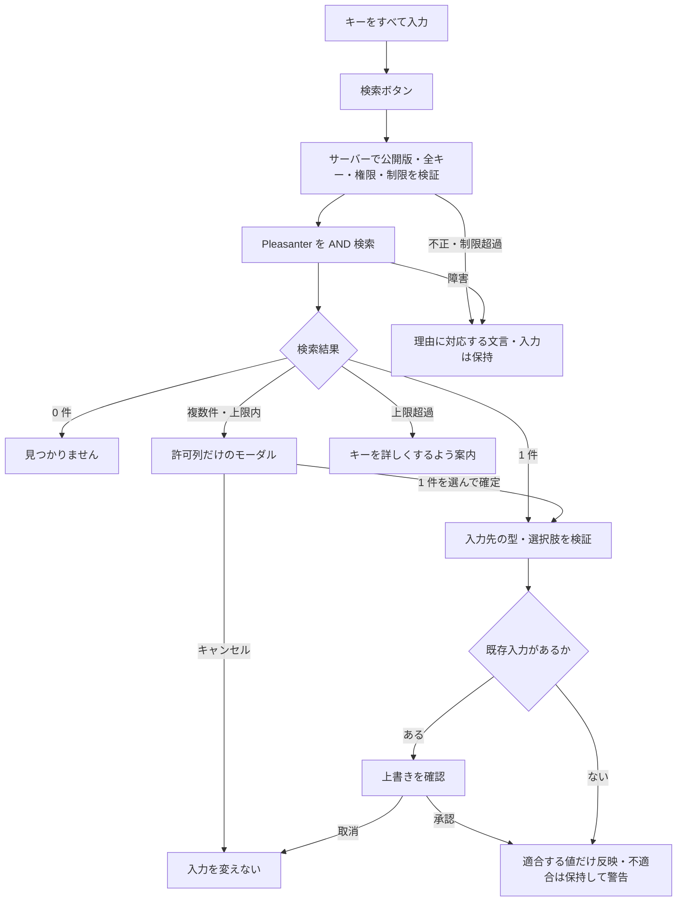

# ルックアップ項目の仕様書

Issue #721・#726。**仕様決定済み、未実装。** 2026-10-26 承認の U1〜U11 を本文と 11 章に反映する。
根拠は [Issue #726 のユーザー承認](https://github.com/vehiclevisionjp/VehicleVision.PleasanterTools.Questionnaire/issues/726)
（参照日 2026-10-26）。数値は設定で変更できる初期値であり、実測で調整する。
システム上限を変更する場合も設定と実測を伴い、フォームの設定だけで超えてはならない。
Pleasanter の実機で確認すべき値は 11.1 節へ分離し、機能の決定と検証済みの事実を混同しない。

関連文書:
[アプリケーション設計](アプリケーション設計.md) /
[データモデル設計](データモデル設計.md) /
[画面設計](画面設計.md) /
[機能一覧](機能一覧.md) /
[設定パラメータ一覧](設定パラメータ一覧.md) /
[非機能設計](非機能設計.md) /
[多言語対応方針](多言語対応方針.md) /
[ルックアップ実機確認-運用手順書](ルックアップ実機確認-運用手順書.md)。

## 1. 目的・用語・決定事項

**N 個のキー項目から Pleasanter の参照元サイトを検索し、選んだ 1 レコードの値を
M 個の入力先項目へ写す。** 郵便番号から都道府県・市区町村・町域を入れる操作などを一般化する。
回答者がボタンを押す方式であり、入力のたびの自動検索や回答送信ではない。

| 用語 | 意味 |
| --- | --- |
| ルックアップ定義 | 1 つの検索ボタンに対応するキー・参照元・入力先・制限の設定 |
| キー項目 | 回答画面の検索入力。N は 1〜5 で、すべて入力が必要 |
| 参照元キー列 | キー項目と対応する Pleasanter の列 |
| 入力先項目 | 検索結果を入れる既存の回答項目。M は 1〜10 |
| 許可列 | 管理者が回答者への返却を許可した参照元の列。モーダルの表示列も含む |
| 専用アカウント | サーバーが検索に使う読み取り専用の Pleasanter アカウント |
| 候補 | 検索条件と参照権限を満たす 1 レコードを、許可列だけに射影したもの |

**ユーザー決定**

- 検索は完全一致の AND が基本。管理者が許可した場合だけ前方一致を使える。
- 0 件なら「見つかりません」、1 件なら自動入力、複数件ならモーダルで 1 件を選ぶ。
- 検索は管理者が設定した専用 API キーでサーバーから行う。
  回答者の Pleasanter セッションや回答保存用のアカウントへ権限を寄せない。
- 許可列以外と、検索条件・公開許可の範囲外のレコードは回答者へ返さない。
- 回答者・IP・フォーム単位のレート制限、1 回の最大件数、全キー必須で乱用を抑止する。
- キーは 1 行テキストと数値だけで、数値も文字列として扱う。
  入力先はテキスト・単一選択・数値。複数選択・日付は初期対象外とする。
- 既存入力があれば反映前に確認する。不適合の項目は変えず警告し、他の項目は反映する。
  取得値が空ならその項目は変えない。
- 管理者が N 個の対応、参照元サイト、M 個の対応、許可列、前方一致可否、
  件数上限、専用 API キーを設定する。秘密は既存の暗号化の仕組みを使う。

## 2. 回答画面の流れ



画面の操作は次のとおり。

- ボタンは起点項目に 1 つ、1 定義に 1 ボタンを置く。ページ末尾の「送信」と区別する。
  全キーが有効になるまで無効にし、足りない項目名を説明する。サーバーでも同じ検証を行う。
- 検索中は処理中表示と二重実行の防止を行う。検索だけでは次ページへ移動しない。
- 0 件・失敗・キャンセル・上限超過では既存入力を消さない。
  上限超過時は候補の先頭だけを選ばせず、キーを絞って検索し直す。
- 要求時のキーと現在のキー、公開版、要求の順序を照合する。
  キー変更後や古い要求の遅延応答を適用せず、モーダルも無効にする。
- 1 件と複数件で同じ入力先検証を使う。選択肢は表示名でなく `Choice.Value` と照合する。
  不一致値を「その他」へ逃がしたり、選択肢を追加したりしない。
  不一致の入力先は変更せず警告し、他の入力先への反映は続ける（部分反映）。
- 既存入力がある場合は反映前に上書きを確認し、取消ならすべて保持する。
  取得値が null・空文字なら、その入力先は変更しない。
- 表示条件・分岐で隠れた入力先へ、通常の入力制御を迂回して値を入れない。
  起点・キー・入力先は同じページだけを許可し、反映時点でも入力先の表示状態を確認する。
- 数値は既存の数値検証と同じ解釈・範囲で検証し、丸め・単位除去・桁あふれの黙認をしない。
  表示書式と保存値を分ける。郵便番号の先頭ゼロは文字列として保持する。
- 反映後は通常の入力変更と同じく、表示条件・分岐・検証・下書きの状態を更新する。
  連鎖するルックアップを自動発動しない。

### 2.1 モーダルとアクセシビリティ

- 見出し、候補一覧、1 件の選択操作、「入力する」「キャンセル」を備える。
  表示列は許可列の部分集合だけにする。行番号は検索内の連番で、レコード ID ではない。
- `dialog` 相当の役割、モーダル属性、見出しとの関連付けを持つ。
  開いたら見出しまたは最初の選択肢へフォーカスを移し、背景を操作対象から外す。
- Tab / Shift+Tab はモーダル内を循環し、ラジオ選択は矢印・Space、
  確定はボタンの Enter / Space、閉じる操作は Escape とキャンセルで行える。
- 閉じたら起点の検索ボタンへ戻す。起点が非表示になった場合の戻し先も試験する。
  選択しないまま確定できないようにし、行クリックだけを操作手段にしない。
- 検索中・候補件数・0 件・反映完了は `role="status"` 相当で通知し、
  エラー・選択肢不一致は関連項目の説明と警告領域で読み上げる。
  色だけで状態を伝えず、高コントラスト・拡大・狭い画面でも操作できること。
- 取得値はプレーンテキストとして描画する。HTML・記法・外部画像・リンクとして解釈しない。

## 3. 設定モデル

### 3.1 既存定義への追加

既存は `Questions.SettingsJson` に項目固有設定、
`QuestionChoices.Value` に保存用の選択値を持ち、
公開時に `SurveyVersions.DefinitionJson` へ固定する
（[データモデル設計](データモデル設計.md) 2.1・2.2）。
ルックアップは複数項目を束ねるため、**新しい回答型を追加するのではなく、
フォーム単位の定義集合と既存項目への参照として追加する**。

| 要素・保存先 | 内容 |
| --- | --- |
| `SurveyLookups`（新規・下書き） | `SurveyId` + `LookupId` をキーとし、非秘密の `DefinitionJson` を持つ |
| `SurveyDefinition.Lookups`（追加） | 公開時に凍結するルックアップ定義集合。回答項目は既存のまま |
| `Questions.SettingsJson.LookupIds`（追加） | ボタンを配置する起点項目からの参照。未指定は従来どおり |
| `LookupCredentials`（新規・サーバー専用） | `CredentialId` / `SurveyId` / API キーの暗号文 / 有効状態 / 更新者・日時 |
| 公開版のサーバー用定義 | 下記設定と資格情報の参照 ID。API キーの平文・暗号文は含めない |
| 回答画面用の定義 | 検索 ID・キー項目 ID・入力先 ID・ボタン文言など、操作に必要な情報だけ |

これは採用する論理モデルであり、テーブル・移行・公開 JSON は未実装。
既存 JSON に追加要素がなければ空の集合と読み、既存アンケートの動作を変えない。
公開用とサーバー用の DTO を分け、スナップショットをそのまま回答画面へ返さない。

### 3.2 ルックアップ定義の内容

| 設定名 | 内容・制約 |
| --- | --- |
| `LookupId` / `AnchorQuestionId` | フォーム内の識別子とボタン起点。1 定義 1 ボタン、起点に 1 つ。重複・不存在は不可 |
| `ButtonLabel` | 任意の `LocalizedText`。未指定は画面カタログの標準文言 |
| `SourceSiteId` / `CredentialId` | 管理者が許可した参照元と、そのフォームで使える専用資格情報 |
| `Keys[]` | `QuestionId` / `SourceColumn` / `MatchMode`。N は 1〜5、すべて AND。同じ列の重複は拒否 |
| `MatchMode` | `Exact` が基本。許可された文字列キーだけ `Prefix` を選べる。回答者は変更不可 |
| `Targets[]` | `SourceColumn` / `QuestionId`。M は 1〜10。同じページの項目のみ。同じ入力先への競合は公開前に検出 |
| `AllowedColumns[]` | 回答者へ返せる列の許可リスト。空は不可。入力元列・モーダル表示列を包含する |
| `DisplayColumns[]` | モーダルに出す列。許可列の部分集合。見出しは `LocalizedText` |
| `MaxResults` | 1 回の最大候補 K。既定 10 件、システム上限 20 件以下の正の整数 |
| `Keys[].AllowPrefix` | 既定 false。管理者がキーごとに許可し、文字列列だけで前方一致を使う |
| キーごとの制約 | 型・既存項目の最大長・前方一致の最短 3 文字。5.3 節の許可文字を検証 |

公開前に項目・列の実在、型の互換性、許可列の包含、資格情報の所属・有効性、
件数の範囲、前方一致の許可をサーバーで検証する。
列定義を取得できなければ、標準の列数を仮定して公開する方式にはしない。
キーは 1 行テキストと数値入力だけで、数値も文字列のまま検索する。
入力先はテキスト・単一選択・数値だけとし、複数選択・日付は対象外とする。
起点・キー・入力先の同一ページ制約も公開前に検証する。

公開済みの N/M 対応・許可列・検索方法・上限はその版で固定する。
資格情報の失効・利用停止は公開し直さず実行時にも効かせ、
キーのローテーションで公開済み JSON を書き換えない。
複製・テンプレート・項目取り込みで資格情報を他フォームへ引き継がず、再登録を求める。

### 3.3 秘密の保存

既存の `SecretProtector` と `QUESTIONNAIRE_SECRET_KEY` による AES-GCM を利用し、
新しい暗号方式や平文の設定列を作らない。
暗号化の文脈をフォーム ID・資格情報 ID に束縛する。
管理 API は設定済みの有無だけを返し、平文も暗号文も再表示しない。
更新・解除・維持を区別し、マスク文字列を新しいキーとして保存しない。

根拠（2026-10-23、既存実装を参照）:
`src/VehicleVision.PleasanterTools.Questionnaire.Core/Definitions/Question.cs` 6-23 行、
`src/VehicleVision.PleasanterTools.Questionnaire.Core/Definitions/QuestionSettings.cs` 7-56 行、
`src/VehicleVision.PleasanterTools.Questionnaire.Web/Services/SecretProtector.cs` 24-48 行。
設定保存の既存方針は [データモデル設計](データモデル設計.md) 2.15。

## 4. 回答画面とサーバーの API

### 4.1 入力

`POST /api/forms/{publicId}/lookups/{lookupId}/search` を新設する。
配置先のサブパスを既存の `basePath` から組み立てる。
キーを URL・クエリ文字列へ含めず、本文で渡す。本文上限は 4 KB（4096 バイト）。
上限超過は外部検索前に拒否し、候補数の上限超過とは区別する。

```json
{
  "version": 3,
  "keys": {
    "postalCode": "1000001",
    "addressKind": "office"
  },
  "lookupSession": "<短命のフォーム限定トークン>"
}
```

`lookupSession` はサーバーが発行するフォーム限定・署名つきの回答者制限用トークンで、
有効期間は 30 分。既存の送信チケットとは目的を分け、検索に送信権限を持たせない。
任意に指定できる `ResponseToken` だけを本人確認や制限の根拠にしない。
新しい識別子を長期保存せず、[多言語対応方針](多言語対応方針.md) の匿名性を維持する。

サーバーは `publicId`・公開版・`lookupId` から設定を解決する。
サイト ID、API キー、列名、検索方法、`View`、並べ替え、件数、ページ位置、
任意レコード ID を回答者から受け付けない。未知のプロパティ・キー ID も拒否する。
下書きや別フォームの定義を選ばせず、受付状態とアーカイブ・メンテナンスも確認する。

### 4.2 出力

成功は `200` とし、`outcome` を `notFound` / `single` / `multiple` で返す。
`notFound` は空配列、`single` は 1 件、`multiple` は 2 件以上かつ上限以下とする。
候補を切り詰めた結果を「1 件」として自動適用してはならない。

```json
{
  "version": 3,
  "outcome": "single",
  "candidates": [
    {
      "candidateKey": "1",
      "display": { "prefecture": "東京都", "city": "千代田区", "town": "千代田" },
      "values": { "prefectureQuestion": "東京都", "cityQuestion": "千代田区", "townQuestion": "千代田" }
    }
  ],
  "warnings": []
}
```

`candidateKey` はその応答内だけの識別子で、Pleasanter の ID ではない。
`display` の鍵は設定上の表示 ID、`values` は入力先項目 ID。
どちらも許可列から生成する。選択は取得済み候補から画面内で行い、
任意 ID を指定して追加取得する公開 API は作らない。
不適合値は `values` へ入れず、項目 ID と警告コードだけで伝える。
許可外の列、参照元キー列の不要な値、サイト・レコード ID、総件数、内部例外は返さない。

### 4.3 エラー

エラーは `code` と安全な `fieldIds`（必要な場合）で伝え、
生の Pleasanter 応答や検索値を本文へ含めない。
表示文言は 7 章の画面カタログから決める。

| HTTP・コード | 条件 | 回答画面の扱い |
| --- | --- | --- |
| `400 LookupInvalidKeys` | 空・不足・過剰・型・長さ・許可文字・予約構文の不正 | 対象キーへ案内。外部検索しない |
| `403 LookupSessionInvalid` | 制限用トークンが無効・期限切れ | 入力を残して再取得を案内 |
| `404 LookupUnavailable` | 不明な公開 ID・定義、下書き、アーカイブ | 内部の存在を区別しない |
| `409 LookupVersionChanged` | 表示中の版と現在の版が違う | 自動再適用せず再読み込みを案内 |
| `409 LookupClosed` | 受付前・終了・停止 | 既存の受付状態に従う |
| `422 LookupTooManyResults` | 上限超過、または全件を確認できない | 候補は返さず、条件の絞り込みを案内 |
| `429 LookupRateLimited` | 回答者・IP・フォームなどいずれかの枠を超過 | `Retry-After` 後の手動再試行を案内 |
| `502 LookupSourceInvalid` | 参照元の権限・設定不整合、不正な応答 | 共通の取得失敗。管理者へ安全な詳細を通知 |
| `503 LookupTemporarilyUnavailable` | メンテナンス、接続・共有ストア障害、同時実行枠満了、外部の 429・5xx | 入力を残し時間をおいて再試行 |
| `504 LookupTimeout` | 外部検索が 5 秒で時間切れ | 自動反復せず手動再試行 |

## 5. Pleasanter の検索（一次情報と実装仕様）

### 5.1 確認した仕様

公式資料と、本リポジトリが指す **`1b7b6e6c930cf6a40c89b0c8c692a63177289bef`**
の公開ソースを参照した。参照日はいずれも **2026-10-23**。
ローカルの `_reference` は未初期化のため、同じコミットの GitHub 上のソースを読んだ。
本体コードの取り込み・サブモジュール変更は行わない。

- 複数レコード取得は `POST /api/items/{サイトID}/get`。
  `ApiKey` は本文へ入れ、`View.ColumnFilterHash` で絞る。
- 異なる列の条件は AND。同じ列に複数の値を渡す指定は OR になり得るため、
  本機能は各キーから単一の検索値を組み立てる。
- 文字列列の `ColumnFilterSearchTypes` は `ExactMatch` / `ForwardMatch` を指定できる。
  省略して参照元の列設定に依存する形にはしない。
- 本文の `Offset` / `PageSize` が取得位置・件数を指定する。
  `PageSize` は Pleasanter 側の設定上限で制限される。
  応答には `Response.Data` / `TotalCount` / `PageSize` / `Offset` がある。
- `View.ApiDataType = KeyValues` のとき `GridColumns` が返却列を指定し、
  キー形式 `ColumnName`、値形式 `Value` を選べる。
  表示名・書式付き値をそのまま回答の選択値や数値へ保存しない。
- サイト統合があると複数サイトのレコードが含まれ得る。
  許可列の指定だけでレコードの公開範囲が守られるとは考えない。

出典:

- [公式: 複数レコード取得][api-get]
- [公式: 共通 JSON（ApiKey・Offset・PageSize）][api-common]
- [公式: View][api-view]
- [公式: ColumnFilter の指定方法（AND・OR・一致方式・特別な値）][api-filter]
- [公式: ApiDataType・GridColumns・値形式][api-type]
- [固定ソース: Api.cs（11-17 行、本文モデル）][source-api]
- [固定ソース: View.cs（75-78 行、検索条件）][source-view]
  の 2930-2946 行（空値・配列の解釈）、3064-3091 行（文字列の完全・前方一致）も参照。

**実機確認の範囲:** 2026-10-23、開発環境文書の `http://localhost:8080` が HTTP 200 を返すことだけ確認。
ルックアップ用の参照サイト・専用アカウント・許可列の確認は未実施で、
検索条件・権限・件数上限・エスケープの実測は未実施。
[既存の実機検証](実機検証結果.md) 7 章の JSON 内トークン検索を、
今回の前方一致や型別検索の検証済み根拠に流用しない。
実装前に [実機確認手順](ルックアップ実機確認-運用手順書.md) を実施し、11.1 節へ結果を記録する。

### 5.2 要求の組み立て

次は文字列の自由入力列 2 本で完全一致 AND 検索する構造例。
値は架空、`PageSize: 11` は既定の最大候補 K=10 件に対する K+1 件の超過検出要求である。

```json
{
  "ApiVersion": 1.1,
  "ApiKey": "<サーバーで復号した専用キー>",
  "Offset": 0,
  "PageSize": 11,
  "View": {
    "ColumnFilterHash": { "ClassA": "1000001", "ClassE": "office" },
    "ColumnFilterSearchTypes": { "ClassA": "ExactMatch", "ClassE": "ExactMatch" },
    "ApiDataType": "KeyValues",
    "ApiColumnKeyDisplayType": "ColumnName",
    "ApiColumnValueDisplayType": "Value",
    "GridColumns": ["ClassB", "ClassC", "ClassD"]
  }
}
```

前方一致を許可したキーだけ `ForwardMatch` に置き換える。
`Search`、否定、任意の OR 条件、関連サイトの列展開は本機能から送らない。
回答者の cookie や管理画面のセッションも Pleasanter へ転送しない。

実装は最大候補数 K に対し K+1 件を要求し、総件数と取得配列の整合も確認する。
K 超過なら 422 で候補を返さず絞り込みを求める。
外部のページ上限が K+1 より小さい設定は有効化を拒否する。
実行中に上限が縮小した場合も停止し、取得配列 1 件だけで一意と決めない。
総件数・取得件数から完結を確認できなければ 422 とする。
上限を超えるページ巡回や、無条件取得してアプリで全件走査する回避はしない。
接続試験で有効な上限と応答形式を確認する。`Take` や `View.PageSize` を仮定しない。

取得は同期の読み取り処理とし、外部検索は 5 秒、同時実行はフォームごとに 4 とする。
応答サイズも有限に制限し、その適用値は 11.1 節の実測記録に残す。
回答送信ワーカーやデッドレターへ検索要求を積まない。
既存クライアントの回答書き込み用の再送分類とは分け、検索を自動反復しない。

### 5.3 検証・エスケープ・インジェクション対策

- JSON は型付き DTO とシリアライザーで生成し、JSON 文字列・SQL・URL を値の連結で作らない。
  列名はサーバー設定と取得済み列定義の許可リストから選び、
  `or_` / `and_`、列式、関連列指定を回答者に注入させない。
- キーは 1 行テキスト・数値入力に限定し、通常の入力正規化後に型・長さ・範囲と全キー必須を検証する。
  `null`、空文字、空白のみ、欠落キーを検索しない。数値ゼロは空と扱わない。
  数値キーも文字列で渡し、先頭ゼロを保持する。検索都合の NFKC 化や数値への変換をしない。
- 制御文字を拒否したうえでキーの前後の空白を除去し、
  英数字・ハイフン・内部の空白・日本語の文字だけを許可する。
  `%`・`_`・`[`・`]`・引用符も拒否し、外部検索しない。
  前方一致は既定無効。管理者がキーごとに許可した文字列列だけ、最短 3 文字で使える。
- **JSON のエスケープだけでは検索構文の注入を防げない。**
  Pleasanter には配列・数値範囲・未設定・`Own` 等を解釈する指定がある。
  管理者が選ぶ列型に応じてサーバーが単一値条件を生成し、
  回答者の配列・範囲式・制御文字・予約値を検索式として通さない。
  リテラル値として安全に検索できない列型・値は明示エラーにする。
- 拒否対象の `%` / `_` / `[` / `]` / 引用符が外部へ渡らないことを確認する。
  別途、隔離した実機で DB 別のリテラル照合を確認する。
  固定ソースには `EscapeValue` を通す経路があるが、DB ごとの実測は未実施。
  未確認の独自バックスラッシュ置換で「安全」としない。
- 引用符、改行、タブ、JSON 風文字列、範囲区切り、予約語、SQL 風文字列で、
  条件の意味や参照範囲が変わらないことを試験する。
  公開前検証と実行時検証を一致させる。実機の結果を理由に許可文字を黙って広げない。

## 6. 安全性・保存・キャッシュ

### 6.1 権限と公開するデータ

- 専用の公開用マスターサイトを別に用意し、専用アカウントにそのサイトだけの読み取りを付与する。
  作成・更新・削除・サイト管理権限は与えず、回答保存用の API キーへ代替しない。
- **匿名の回答者がキーを知れば取得できる機能であり、キーは本人認証ではない。**
  公開不可の個人情報を、推測可能なキーとレート制限だけで守らない。
  公開用マスターで公開可能な集合を先に限定する。
- **実機で公開対象を担保できると確認するまで有効化しない。**
  サイト統合・継承で参照範囲が広がる構成は初期対象外とする。
  管理画面には「キーを知る回答者が取得できるデータだけを許可する」警告を必ず表示する。
- 上流の列選択に加え、アプリの応答直前にも許可列と M 個の対応で再射影する。
  `Title`・内部 ID・作成者等が上流応答に付いても丸ごと返さない。
- 外部の接続先は既存の管理済み Pleasanter 接続先を使う。
  回答者に URL を渡させず、資格情報を別ホストやリダイレクト先へ送らない。
- 許可列・資格情報・公開状態は要求ごとに確認する。
  権限がなくなったとき、過去の成功結果や別アカウントで穴埋めしない。

### 6.2 乱用防止と観測

- 検索専用に回答者・IP・フォームの各枠を同時に適用し、
  どれかが超過したら Pleasanter を呼ぶ前に拒否する。
  トークン発行も IP・フォームの枠で制限し、取り直しによる回避を抑止する。
- 回答者は匿名セッション単位の抑止で、本人の一意性は保証しない。
  IP は信頼したプロキシ経由の値を使い、任意の転送ヘッダーで変更させない。
- 回答者の枠は 5 分 30 回、IP の枠は 5 分 60 回、フォームの枠は 1 分 120 回とする。
  回答者の識別には有効期間 30 分の署名つきトークンを使う。
- 全キー必須に加え、前方一致は最短 3 文字、N 最大 5、M 最大 10、要求本文 4 KB、
  候補は既定 10 件・システム上限 20 件、外部検索 5 秒、同時実行はフォームごとに 4 とする。
  上限なし、全一覧、任意のページング、空キーでの探索経路を作らない。
- 既存の共有レート制限を再利用し、複数インスタンスでも各枠を共有する。
  共有ストア障害時は拒否側（安全側）とし、プロセス内への退避で制限を緩めない。
- ログ・監査・トレース・例外・APM・WAF の本文記録へ、キー値・取得値・API キーを出さない。
  値のハッシュも探索可能な個人情報になり得るため残さない。
  ステータス、失敗分類、所要時間、相関 ID、設定変更の主体など必要なメタデータだけを扱う。
- 参照権限・資格情報の不備は管理者に通知し、回答者には内部情報なしの取得失敗を出す。
  正常な 0 件とは区別する。検索失敗を黙って 0 件へ置き換えない。

### 6.3 キャッシュと回答保存

- 検索結果を要求処理と開いている画面の候補保持に限定する。初期実装にサーバー側の結果キャッシュは入れない。
  HTTP は成功・エラーとも `Cache-Control: no-store` とし、共有キャッシュ・CDN・
  Service Worker・永続ストレージへ検索結果を保存しない。
- キー変更・モーダル終了・画面離脱で不要な候補を破棄する。
  サーバー側の結果キャッシュは実測で必要になった場合に別途判断し、勝手に追加しない。
- 入力先へ反映された値は通常の回答値になる。
  送信時の検証・回答 JSON・既存マッピング・送信待ち・回答編集に従って保存するだけで、
  検索専用の回答履歴や参照元レコードとの同期を作らない。
- **参照元への Create / Update / Delete は一切行わない。**
  回答保存先への既存の書き込みは別経路・別資格情報として維持する。
- 回答者は反映後の値を通常どおり編集できるため、ルックアップ値を検証済みの本人情報と扱わない。
  送信時に元レコードを再検索して同一性を保証する機能ではない。
- `AllowDraft` が有効なら、反映後の値も既存の端末内下書きに含まれ得る。
  候補キャッシュとは区別し、共有端末への注意と既存の保存・破棄・保持期限を適用する。

## 7. 文言・多言語

[多言語対応方針](多言語対応方針.md) に従い、画面自身の文言をキー化する。
回答者の言語を検索本文へ追加せず、言語選択は回答に保存しない。
API は機械可読コードを返し、画面が選択言語 → `en` → `ja` の順で表示する。
項目名・ボタンの任意文言・表示列見出しは `LocalizedText` と公開版の落とし先を使う。

以下は追加予定のキーと日本語原文。今回カタログは変更しない。
実装時に回答画面・管理画面それぞれのカタログへ追加し、7 言語と差し込み引数を検証する。
取得値は翻訳文言にせず、ログにも渡さない。

| キー | 日本語原文 |
| --- | --- |
| `lookup.search` | 検索して入力 |
| `lookup.keysRequired` | 検索に必要な項目をすべて入力してください。 |
| `lookup.searching` | 検索しています。 |
| `lookup.notFound` | 見つかりません。入力内容を確認してください。 |
| `lookup.chooseTitle` | 入力する候補を選んでください |
| `lookup.candidateCount` | {count} 件の候補があります。 |
| `lookup.apply` / `lookup.cancel` | 入力する / キャンセル |
| `lookup.applied` | 検索結果を入力しました。 |
| `lookup.confirmOverwrite` | 入力済みの値を検索結果で上書きしますか。 |
| `lookup.choiceUnavailable` | {question} の選択肢にないため入力できません。 |
| `lookup.valueInvalid` | {question} に入力できない値です。 |
| `lookup.tooMany` | 候補が多すぎます。検索する値を詳しくしてください。 |
| `lookup.failed` | 取得できませんでした。しばらくしてから再度お試しください。 |
| `lookup.rateLimited` | 検索回数の上限に達しました。{seconds} 秒後に再度お試しください。 |
| `lookup.versionChanged` | フォームが更新されました。再読み込みして内容を確認してください。 |
| `lookup.sessionExpired` | 検索の有効期限が切れました。検索をやり直してください。 |
| `lookup.closed` | 現在、このフォームでは検索できません。 |
| `lookup.invalidKeys` | 検索する値を確認してください。 |
| `lookupAdmin.title` | ルックアップ設定 |
| `lookupAdmin.keys` / `lookupAdmin.targets` | キー項目と参照元列 / 入力元列と入力先項目 |
| `lookupAdmin.sourceSite` / `lookupAdmin.allowedColumns` | 参照元サイト / 返却を許可する列 |
| `lookupAdmin.prefix` / `lookupAdmin.maxResults` | 前方一致を許可 / 最大候補件数 |
| `lookupAdmin.credential` / `lookupAdmin.credentialConfigured` | 専用 API キー / 設定済み |
| `lookupAdmin.test` / `lookupAdmin.testFailed` | 接続を確認 / 接続または読み取り権限を確認できません。 |
| `lookupAdmin.publicDataWarning` | キーを知る回答者が取得できるデータだけを許可してください。 |

管理画面の追加検証・削除確認などの文言も同じ接頭辞でキーを設ける。
サーバーが表示文言を返す必要が生じた場合は `ServerMessageKeys` / `ServerMessages` を使い、
回答画面の言語非送信方針を変更するかを先に判断する。

## 8. 管理画面の設定 UI

アンケート編集画面に「ルックアップ設定」を追加し、
既存の「割り当て」（回答から保存先列への書き込み）と検索の入力先対応を混同させない。

1. アンケート管理者がルックアップを追加し、名前・ボタン起点・任意の多言語ボタン文言を設定する。
2. 管理済み接続先の参照サイトと専用 API キーを登録する。
   マスク表示と維持・更新・解除を分け、再表示・コピーは提供しない。
3. 接続と読み取り権限を確認し、列定義を取得する。
   接続試験でも更新・削除を実行しない。失敗時は安全な理由を管理者へ出す。
4. N 個のキー項目と参照元キー列を対応させる。
   N は最大 5、同じページの 1 行テキスト・数値だけとする。
   完全一致を基本とし、前方一致は既定無効、許可時は文字列列だけ・最短 3 文字とする。
5. 許可列とモーダル表示列を選び、M 個の入力元列と入力先項目を対応させる。
   M は最大 10、同じページのテキスト・単一選択・数値だけとする。
   部分反映・空値の保持を明示し、「キーを知る回答者が取得できるデータだけを許可する」と警告する。
6. 最大候補件数（既定 10 件・システム上限 20 件）を確認し、下書きを保存する。
   既存の `DraftRevision` による競合検知へ含める。
7. プレビューとテスト公開で 0/1/複数件、エラー、権限を確認して公開する。
   読み取り専用であっても参照元の実データへアクセスすることを警告する。

管理 API にも既存の認証・CSRF 対策と権限検証を適用する。
設定・API キー・接続試験は「アンケート管理者」だけに許可する。
管理画面の下書きプレビューには認証・権限検証つきの別経路を使う。
通常の公開検索 API から下書きへアクセスさせない。
項目・列・資格情報の削除や型変更は、参照する定義と影響する公開版を表示して扱う。
型や対応を変更する場合は公開前検証をやり直し、新しい定義は再公開で適用する。
利用停止・キー失効は再公開なしで全公開版の実行時に適用し、複製時は資格情報を再登録する。
11.1 節の実測が完了しない参照元と、上流上限が K+1 件未満の設定は有効化しない。

## 9. 試験の観点

最大候補 K は既定 10 なので 9 / 10 / 11 件、上限設定 K=20 では 19 / 20 / 21 件を試験する。
N は 4 / 5 / 6、M は 9 / 10 / 11、本文は 4095 / 4096 / 4097 バイト、
前方一致は 2 / 3 / 4 文字、同時実行はフォームごとに 3 / 4 / 5 要求を試験する。
レートは回答者 29 / 30 / 31 回、IP 59 / 60 / 61 回、フォーム 119 / 120 / 121 回と時間窓の境界、
トークンは 30 分の期限前・期限到達・期限後、外部検索は 5 秒の境界で確認する。
設定変更時は変更後の境界も使い、既定値に固定した試験だけにしない。
「制限がある」だけでなく、外部呼び出し回数・返却件数・項目集合まで検証する。

| 層 | 主な観点 |
| --- | --- |
| 単体: 定義 | N/M が 0、重複 ID、別フォーム参照、型不一致、許可列不足、資格情報不備、既存 JSON 互換、公開用 DTO の秘匿 |
| 単体: 条件 | N 個の AND、完全一致、許可時だけ前方一致、未入力・空白・ゼロ、正規化・最大長、配列・範囲・予約値の拒否 |
| 単体: 結果 | 0/1/2/K/K+1、ページ欠落・総件数不整合で一意判定しない、許可列以外の除去、型・選択値の警告 |
| 単体: 状態 | 遅延・逆順応答、キー変更、キャンセル、既存値保持、表示条件再評価、連鎖検索しない |
| 単体: 秘密・制限 | 暗号化と文脈分離、復号失敗、キー失効、各レート枠の境界、IP 偽装、期限切れトークン |
| 結合: Pleasanter 実機 | 対象版・DB を記録し、列型別の AND・一致方式、先頭ゼロ、ワイルドカード・引用符・予約値を確認 |
| 結合: 権限 | 専用読み取りアカウントで許可レコードだけを返す。拒否レコード・列、サイト統合、継承、失効を確認 |
| 結合: 外部異常 | 401/403/404/429/5xx、タイムアウト、不正 JSON、応答過大、外部ページ上限が K+1 未満 |
| 結合: DB・共有状態 | 4 RDBMS の保存・移行・削除・版固定・競合、秘密の非露出、複数インスタンスと共有ストア障害 |
| E2E: 回答 | ボタンから 0/1/複数件、モーダル選択・取消、選択肢不一致、上限・レート超過、入力保持、編集・下書き |
| E2E: 管理 | 保存・接続試験・公開、公開版と下書きの分離、役割・CSRF、複製・取り込み時の資格情報非継承 |
| E2E: 表示 | 7 言語とフォールバック、読み上げ、フォーカス復帰、全キーボード操作、狭幅・拡大・配色・サブパス |
| 横断 | API・HTML・ログ・APM・ブラウザ保存に秘密や候補が漏れない。反映値以外を回答へ保存せず、参照元への書き込みゼロ |

実機試験は公開用の架空データと専用アカウントを準備して行い、
本番の個人情報を試験ログや成果物へ残さない。

## 10. 後続の実装タスク

| タスク | 成果物・完了条件 | 前提 |
| --- | --- | --- |
| 実機確認（実測） | 実機確認手順書を実施し、11.1 節と結果記録へ対象版・DB・列型・権限・検索・上限を残す | 最初に実施。現状は未実施 |
| バックエンド: 定義・保存 | Core の定義と検証、4 DB の下書き・版固定、公開 DTO、専用資格情報の暗号化・失効 | 上流の実測 |
| バックエンド: 読み取り | 専用クライアント経路、型別 AND 条件、射影、件数・応答・時間の制限、外部異常の分類 | 定義・保存 |
| バックエンド: 公開 API | フォーム状態・版・トークン・レート・同時実行数・ログ秘匿、入力・出力契約の試験 | 読み取り |
| フロント: 回答画面 | ボタン・0/1/複数件・モーダル・競合応答対策・通常入力への反映・アクセシビリティ | API 契約 |
| 管理画面 | N/M 対応・許可列・秘密 UI・接続試験・権限・公開前検証・複製等の扱い | 定義・管理 API |
| 翻訳・試験・文書 | 7 言語、結合・E2E、設定の実値と出典、運用時の権限・キー更新・障害手順 | 各実装 |

各タスクは対応する単体試験を含め、実装変更時は `dotnet build` と対象試験、
フロント変更時は既存の型検査・ビルドを行う。
文書では「決定済み・未実装」と実装済みを区別し、実装時に設定の読み取り箇所を関連一覧へ追記する。
最初のタスクの具体的な手順・試験データ・記録様式は
[ルックアップ実機確認-運用手順書](ルックアップ実機確認-運用手順書.md) に定める。
最初の工程では上流の検索・権限・上限を実測し、本アプリ経由の再試験は各実装後に行う。
実装後の試験まで完了して初めて、有効化の総合判定を行う。

[api-get]: https://pleasanter.org/ja/manual/developers-guide/api/table-operations/api-record-get-multi/
[api-common]: https://pleasanter.org/ja/manual/developers-guide/json-data-layout/api-common/
[api-view]: https://pleasanter.org/ja/manual/developers-guide/json-data-layout/api-view/
[api-filter]: https://pleasanter.org/ja/manual/developers-guide/json-data-layout/api-view/api-view-columnfilter/
[api-type]: https://pleasanter.org/ja/manual/developers-guide/json-data-layout/api-view/api-view-apidatatype/
[source-api]: https://github.com/Implem/Implem.Pleasanter/blob/1b7b6e6c930cf6a40c89b0c8c692a63177289bef/Implem.Pleasanter/Libraries/Requests/Api.cs
[source-view]: https://github.com/Implem/Implem.Pleasanter/blob/1b7b6e6c930cf6a40c89b0c8c692a63177289bef/Implem.Pleasanter/Libraries/Settings/View.cs

## 11. 決定事項（2026-10-26 承認）

U1〜U11 はすべて決定済み。根拠は Issue #726 のユーザー承認であり、Pleasanter の実測結果ではない。
数値は設定可能な初期値で、実測で調整する。未実装の設定名は論理名であり、現行製品の設定ではない。

| ID | 決定 | 根拠 | 実装で守る点 |
| --- | --- | --- | --- |
| U1 | 3 章のモデルを採用。起点に 1 つ、1 定義に 1 ボタン。キー・入力先は同じページ | 決定済み（ユーザー承認） | 非表示の入力先に入れない。公開前と反映時に検証 |
| U2 | キーは 1 行テキスト・数値（文字列扱い）。入力先はテキスト・単一選択・数値 | 決定済み（ユーザー承認） | 複数選択・日付は初期対象外。先頭ゼロを保持 |
| U3 | 既存入力は反映前に確認。不適合は保持・警告し他は部分反映。空の取得値は保持 | 決定済み（ユーザー承認） | 1 件・複数件で同じ検証。取消では全入力を保持 |
| U4 | 候補既定 10・上限 20 件、N 最大 5、M 最大 10、本文 4 KB、外部 5 秒、同時実行はフォームごとに 4 | 決定済み（ユーザー承認） | 設定値と境界を検証。K+1 件を要求し超過を検出 |
| U5 | 共有レート制限を再利用。回答者 5 分 30 回・IP 5 分 60 回・フォーム 1 分 120 回、署名トークン 30 分 | 決定済み（ユーザー承認） | 共有ストア障害時は拒否。長期識別・プロセス内退避をしない |
| U6 | 前方一致は既定無効、キーごとに管理者が許可。文字列列だけ、最短 3 文字 | 決定済み（ユーザー承認） | 英数字・ハイフン・空白・日本語だけ。前後空白除去。特殊文字等は 5.3 節で拒否。DB 別照合を実測 |
| U7 | 設定・API キー・接続試験はアンケート管理者だけ。複製時は資格情報再登録 | 決定済み（ユーザー承認） | 停止・失効は再公開なしで実行時にも適用 |
| U8 | 実機で確認するまで有効化しない。別の公開用マスターと、そのサイトだけを読む専用アカウントを使う | 決定済み（ユーザー承認） | サイト統合・継承で範囲が広がる参照元は初期対象外。公開データの警告を必須表示 |
| U9 | 4 章の経路・HTTP・コードを採用。管理プレビューは公開用と別経路 | 決定済み（ユーザー承認） | 公開 API から下書きを引かせない。上限超過は 422 |
| U10 | 初期はサーバー側の結果キャッシュを導入しない | 決定済み（ユーザー承認） | 実測で必要なら別判断。HTTP は no-store |
| U11 | 実装前に対象版・DB で AND・射影・件数・上限・先頭ゼロ・ワイルドカードを実測 | 決定済み（ユーザー承認） | 上流上限が K+1 件に足りない設定は有効化を拒否 |

### 11.1 実測後に確定する値

決定の再審議ではなく、決定を安全に実装できる対象版・設定値・証跡を確定する欄。
2026-10-26 時点で以下はすべて **未実施**。合格記録がそろうまで有効化しない。
[実機確認手順書](ルックアップ実機確認-運用手順書.md) の記録 ID と証跡を転記する。

| 対象 | 実測後に確定する値・条件 | 状態 | 実測結果・証跡・記録日 |
| --- | --- | --- | --- |
| U6 | DB 別のリテラル照合、大小文字・空白・日本語、予約値の拒否条件 | 未実施 | 未実施 |
| U8 | 公開用サイト・専用アカウントの実効権限、統合・継承による範囲拡大の検出 | 未実施 | 未実施 |
| U11 | 対象版・DB・列型、AND・射影・先頭ゼロ、件数・PageSize の実効上限 | 未実施 | 未実施 |
| U11・資源 | 応答サイズの有限上限、所要時間・応答バイト数、初期値の調整結果 | 未実施 | 未実施 |
