# 画面設計

Google Forms / Microsoft Forms に近い見た目・操作感にする。
対応する機能の範囲は [`機能一覧.md`](機能一覧.md)。

## 1. 回答画面

### 画面遷移

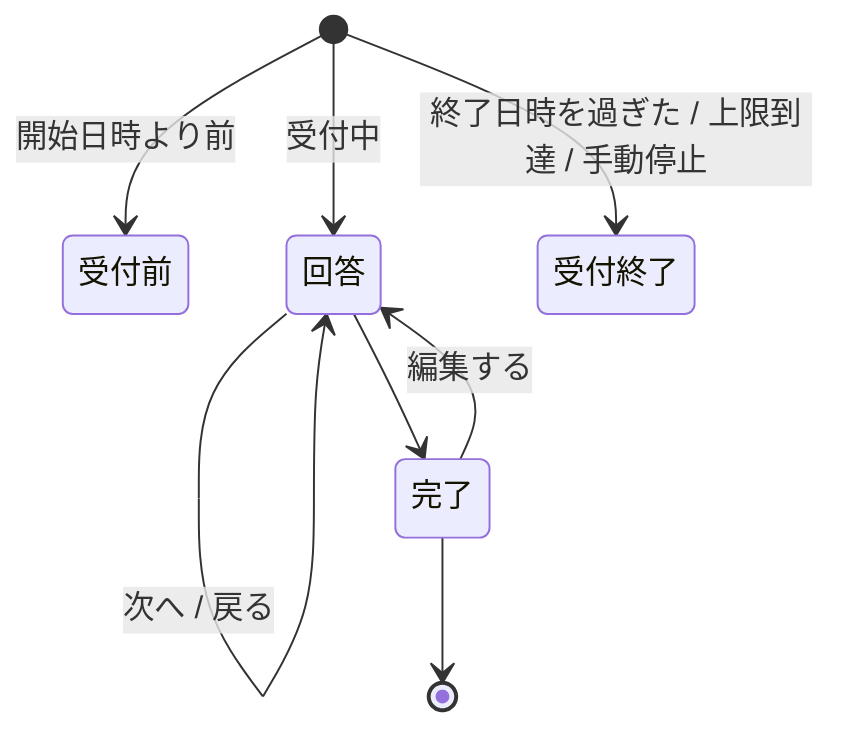

### 各画面

| 画面 | 内容 |
| --- | --- |
| 回答 | 設問。ページ分割・進捗バー・「次へ / 戻る」 |
| 完了 | 説明文と同じ安全な記法で書いた確認メッセージと自前画像・配布リンク。「別の回答を送信」「回答を編集」の導線 |
| 受付前・受付終了 | **理由を明示する。** 「エラー」で済ませない |
| 既に回答済み | 同じ端末からの再訪。編集するか、新しく回答するかを選ばせる |

**「既に回答済み」は Web Storage と Cookie の印で判定する。**
**防止ではなく抑止**であり、消されたら普通の回答画面に戻る

### ページ下部の釦（Issue #624）

ページごとに「前へ」「次へ」「送信」と 0 個以上の任意リンクを置き、設問と同じ回答条件で
表示・非表示、有効・無効を切り替える。条件を指定しなければ従来どおり常に表示し、有効にする。

- 条件が参照できるのは、そのページより前または同じページの設問
- 無効な釦には、条件を満たしていないため押せないことを文字でも示す
- 任意リンクは `http:`、`https:`、`mailto:` の絶対 URL だけを許可し、
  `rel="noopener noreferrer"` を付ける
- 任意リンクは回答を保存・送信しない。移動すると未保存の入力が失われる
- 送信釦の表示条件と有効条件はサーバでも再評価し、満たさない送信を
  `SubmitButtonConditionNotMet` で拒否する
- 全釦が同じ表示条件で隠れて操作不能になり得る定義、許可されない URL、
  重複した任意リンク ID は公開前に拒否する

条件評価は
`src/VehicleVision.PleasanterTools.Questionnaire.Core/Flow/ConditionEvaluator.cs`
15-31 行、サーバ側の送信拒否は
`src/VehicleVision.PleasanterTools.Questionnaire.Core/Validation/AnswerValidator.cs`
79-93 行、回答画面は
`src/VehicleVision.PleasanterTools.Questionnaire.Frontend/src/App.svelte`
312-317、957-1031 行で確認した（2026-10-16）。

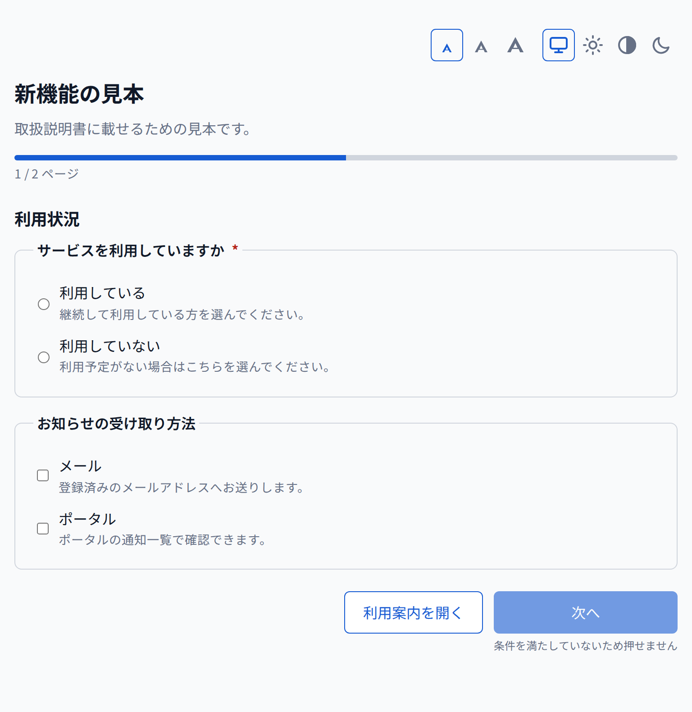

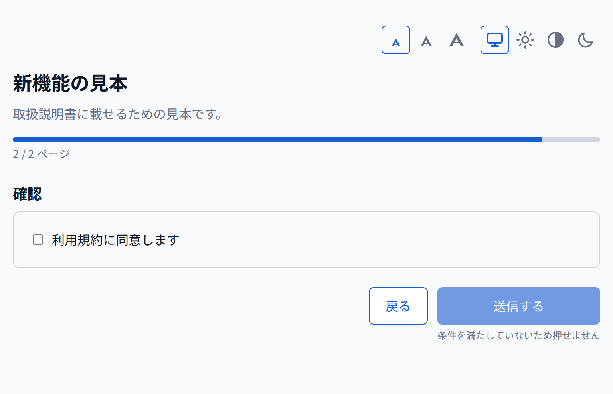

### ルックアップの検索と入力（決定済み・未実装、Issue #721・#726・#728）

起点項目に 1 つ、1 定義に 1 ボタンを置く。キーと入力先は同じページだけとする。
キーは 1 行テキスト・数値（文字列扱い）だけ。全キー入力後に実行し、0 件は案内、
1 件は自動入力、複数件は許可列だけのモーダルから 1 件を選ぶ。
入力先はテキスト・単一選択・数値とし、複数選択・日付は初期対象外。
既存入力があれば反映前に確認する。不適合はその項目を保持・警告し、他の項目は部分反映する。
空の取得値・非表示の入力先は変更しない。検索失敗・取消でも既存入力を保持する。
候補は既定 10 件・システム上限 20 件。超過時は候補を出さず、絞り込みを案内する。
モーダルはフォーカスの移動・閉じた後の復帰、キーボード操作、状態の読み上げを備える。

配置・応答競合・アクセシビリティと文言キーの詳細は
[ルックアップ項目の仕様書](ルックアップ項目の仕様書.md) 2・7 章を参照。
制限値は [設定パラメータ一覧](設定パラメータ一覧.md) の設定可能な初期値で、実測で調整する。

参照元は Pleasanter サイトまたは日本郵便 API。日本郵便は郵便番号キー 1 個に固定し、
半角数字 7 桁がそろうまで検索ボタンを無効にする。3〜6 桁の前方一致は許可しない。
入力先は日本郵便の許可された応答列に対応する M 個で、複数の町域も共通モーダルから選ぶ。
上限超過は候補なしとし、郵便番号の確認と管理者への問い合わせを案内する。
外部異常は共通の取得失敗を表示し、秘密・トークン・生の応答は表示しない。
郵便番号を日本郵便へ送る旨はプライバシー・利用目的の通知に記載する。
回答画面での個別開示の要否・文言・位置は未決で、公開前に判断する（仕様書 13 章）。

### 書きかけの回答（Issue #59）

**端末の中だけに残す。** サーバへは送らない。

⚠️ **アンケートごとに切り替え、既定は無効**（`Surveys.AllowDraft`）。
端末は共有され得る（店頭のタブレット、共用 PC）ので、
**黙って残すと次に使う人が前の人の回答を見る。**

- **勝手には戻さない。** 「前回の続きが残っています」と出し、
  **再開するか破棄するかを回答者が選ぶ**
- **破棄する口を必ず置く。** 共有の端末で、前の人の回答を消せるようにする
- **7 日で捨てる。** 読んだ時点で期限を見て、過ぎていればその場で消す
- **送信できたら消す。** 端末へ残し続けない
- **添付は残さない。** `File` は保存できないうえ、中身を端末へ写すのは重すぎる
（[`非機能設計.md`](非機能設計.md) 1 章「多重投稿の抑止」）。
`AllowEditingAfterSubmit` が有効でも、**前回の回答が読み出せなければ編集の導線は出さない。**
押しても何も入っていない画面が出るだけになる。

### 見た目（デザイン）の基準（Issue #776）

**色・書体・形・余白・影のトークンは、VehicleVision の DesignReference（internal）を基準にする。**
独自の決まりをこのアプリに溜めない。足りないものは DesignReference に足す。

- 色は `Frontend/src/styles/tokens.css`（DesignReference の `css/colors-explicit.css`。第 2.1 版、コミット `7c60bae`、
  2026-11-01 参照）。**手で直さず**、DesignReference の `tokens/colors.json` から生成し直したものを写す。
  **明示型**で、既定はライト。`data-theme="dark"` のときだけダーク（読みやすさ設定で「ダーク」を選んだとき）
- 書体・文字サイズ・余白・角丸・影・フォーカスリング・動きを減らす設定は `styles/base.css`（`css/app-base.css` が土台）。
  文字サイズと余白は、読みやすさ設定（文字の大きさ）に追従するよう px ではなく rem で持つ（16px 基準で同じ値）
- 画面は `--accent` `--bg` `--surface` `--text` `--muted` `--border` `--border-strong` などの**意味名**で色を引く。
  回答画面ではアンケートの作成者のテーマ（`lib/theme.ts`。プリセット・個別色・配色固定）がこの名前を上書きする。
  **作成者がテーマを選んだ回答画面は、そのテーマを尊重する。** 何も選ばなかったときの既定値だけが DesignReference の色になる
- 蜜柑 `--color-accent` は文字の色にしない。部品の枠は `--border-strong`（面に対し 3:1 以上）
- アイコンは Google の Material Icons（管理画面だけ同梱）。管理画面のファビコンは DesignReference のもの。
  回答画面は作成者のものなので、製品のアイコンを出さない
- 色の組み合わせのコントラスト（文字 4.5、枠・図形 3）は `lib/tokens.test.ts` が、ライト・ダークの両方で検査する

### 守ること

- **ページ間の入力はクライアント側で保持し、最後に 1 回だけ送信する。**
  ページごとに送るとレコードが分裂する
- **必須チェックはページ遷移時に、そのページ分だけ行う。**
  最後にまとめて出すと、どのページに戻ればよいか分からない
- **確認・同意は見出し全体を押せる単一のチェックボックスにする。**
  必須の場合は未回答だけでなく未チェックも先へ進めない。
- **通常の設問の説明文は複数行で入力でき、設問ごとにプレーンか記法を選ぶ。**
  プレーンを既定とし、改行だけを反映する。記法を選んだ場合は説明文ブロックと同じ
  `NoteMarkup` が作る安全な要素だけを表示する。HTML を直接表示する経路は持たない（#267）。
  説明文ブロック（`Note`）は従来どおり記法を既定とする。
- **記法の画像は ``、配布リンクは
  `[表示文](asset:GUID)` だけを受け付ける。** 外部 URL を画像として解釈しない。
  既定では PDF・DOCX・XLSX・PPTX・PNG・JPEG・GIF・WebP を本アプリから配信する。
  画像だけを `![…]` で画面へ埋め込み、画像以外は `[…]` のリンクにする。
  1 件 10 MB 以内、アンケート当たり 20 件までとする（#266）。
- **完了画面の本文も説明文と同じ `NoteMarkup` で構造化して表示する**（#269）。
  完了画面からだけ参照される配布物は、回答を完了した人だけが取得できる（#318）。
  「完了したときだけ」では送信成功時に 30 分有効な署名付きセッション Cookie を直接立て、
  引換券を保存しない。「受付期間に合わせる」「回答から N 日」では、引換券を URL の断片
  `/f/{publicId}#d={ticket}` で渡し、画面が引き換えたら成否にかかわらず断片を消す。
  引換後の Cookie は資産配信の経路だけへ送り、期限内は同じ引換券を何度でも使える。
  実装根拠は
  `src/VehicleVision.PleasanterTools.Questionnaire.Core/Definitions/SurveyDefinition.cs`
  38 行、
  `src/VehicleVision.PleasanterTools.Questionnaire.Web/Endpoints/AdminSurveyEndpoints.cs`
  443 行、
  `src/VehicleVision.PleasanterTools.Questionnaire.Web/Endpoints/FormEndpoints.cs`
  155 行、
  `src/VehicleVision.PleasanterTools.Questionnaire.Frontend/src/admin/components/SurveyEditor.svelte`
  609-624 行（2026-09-16 確認）。
- **確認・同意の補足も、通常の設問と同じくプレーンか記法を選ぶ。**
  記法では説明文ブロックと同じ安全な記法で `https:` のリンクを置ける（#257、#267）。
  実装根拠は
  `src/VehicleVision.PleasanterTools.Questionnaire.Frontend/src/components/QuestionField.svelte`
  177-232 行（2026-09-16 確認）
- **送信に失敗したら、入力内容を画面から消さない。** 完全匿名なので、
  失われたら再入力してもらう以外に手が無い
- **ハニーポット項目を 1 つ置く。** 画面にも読み上げにも出さず、キーボードでも辿れない場所に置く
  （`aria-hidden` ＋ `tabindex="-1"` ＋ 画面外）。**自動入力に拾われる名前を付けないこと。**
  拾われると正規の回答者を弾く
- **送信チケットが取れなければ回答させない。** 送信の段で断られる画面を見せる方が悪い
- **設問のシャッフルと分岐は併用しない**（順序が変わると分岐先が壊れる）。
  管理アプリ側で併用を禁止する
- **1 問 1 ページ表示**はアンケート全体の表示モード。設問側の設定ではない
- **テーマ（色・書体）で自由な CSS を書かせない**（Issue #56）。
  受け付けるのは `#rgb` / `#rrggbb` の色 6 本と、決め打ちの書体の並びから選んだ 1 つだけ。
  **検査せずに CSS へ流すと、`</style>` などを混ぜて画面を乗っ取られる**
    - 反映は CSS のカスタムプロパティへの代入だけで行い、**スタイル表を組み立てない**
    - **設定しなければ既定の見た目のまま**（`styles/base.css` の `:root` に書いてある値がそのまま効く。
      既定値は DesignReference のトークン `styles/tokens.css` から引く。テーマの仕様は変えない）
- **見る人の読みやすさ設定を、回答画面の上部へ置く**（Issue #340）。
    - 回答画面では文字と配色の選択肢をアイコンのボタンで横に並べる（Issue #592）。
      選んでいるものは枠と `aria-pressed` で示し、名前は `aria-label` / `title` で伝える。言語の切り替えは画面の下の
      リンクへ移した（文言を持つ言語が 2 つ以上のときだけ。`_documents/多言語対応方針.md` 2 章）
    - 文字は「標準 / 大 / 特大」、配色は「OS に合わせる / 作成者のテーマ / 高コントラスト / ダーク」
      から選ぶ
    - 回答者が選んだ配色を作成者のテーマより後に適用し、必ず優先する。ヘッダ画像は残す
    - **既定はライト**（Issue #776。VehicleVision の DesignReference の「明示型」）。保存値も配色の固定も無いときは、
      OS の `prefers-color-scheme: dark` に従わない。ダークになるのは、見る人が「ダーク」を選んだとき、
      作成者が配色固定で `Dark` を選んだとき、見る人か作成者が「OS に合わせる」を選んだとき（`System`）だけ。
      `prefers-contrast`（高コントラスト）と `prefers-reduced-motion` は初期値でも OS に従う
    - 明示した文字寸法と配色は端末の `localStorage` だけへ保存する
    - `localStorage` を読み書きできない場合も、その場の切替と回答は続けられる
    - 管理画面にも同じ部品をヘッダへ置き、状態・保存・CSS への変換を回答画面と共有する
    - 色覚特性のシミュレーションは行わない。必須は `*` と読み上げ用の「必須」、
      入力誤りは文言と `role="alert"`、公開状態などは状態名そのものを表示し、色だけに頼らない
    - 実装根拠は
      `src/VehicleVision.PleasanterTools.Questionnaire.Frontend/src/lib/readability.ts`
      85-219 行、
      `src/VehicleVision.PleasanterTools.Questionnaire.Frontend/src/App.svelte`
      115-222、672-695 行、
      `src/VehicleVision.PleasanterTools.Questionnaire.Frontend/src/admin/AdminApp.svelte`
      46-57、416-437 行（2026-09-20 確認）

    回答画面（作成者のテーマ・標準の文字）:

    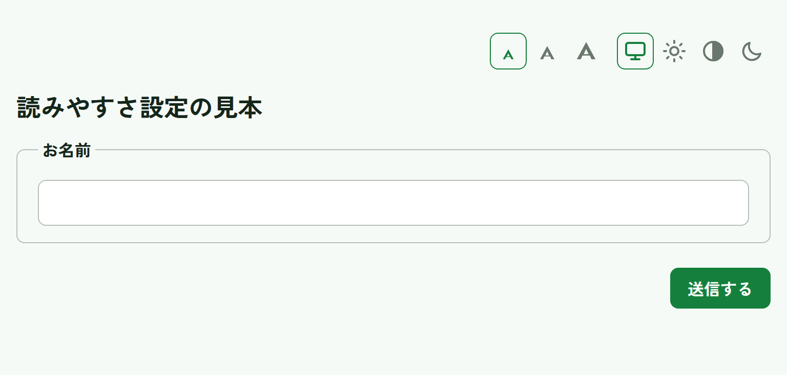

    回答画面（作成者のテーマ・特大の文字）:

    

    回答画面（高コントラスト）:

    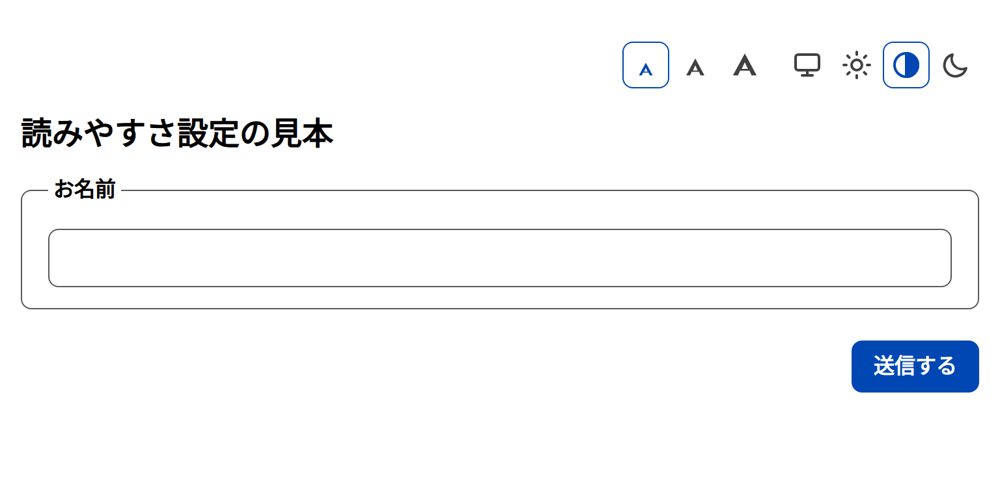

    回答画面（ダーク）:

    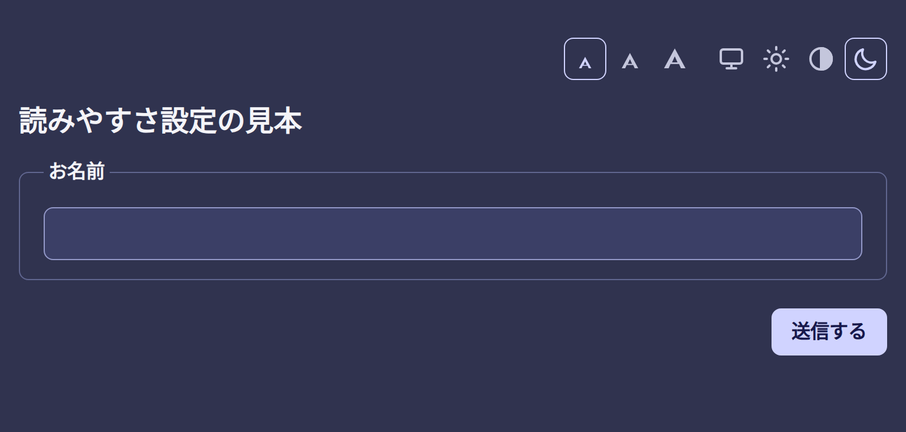

    回答画面（高コントラスト・必須入力エラーと単一選択）:

    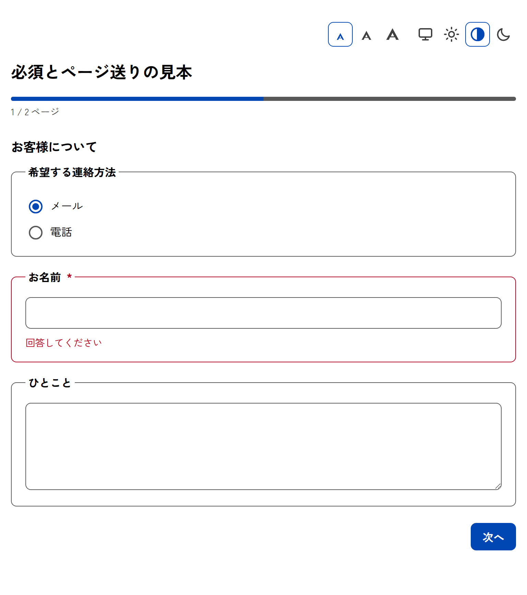

    管理画面（ダーク）:

    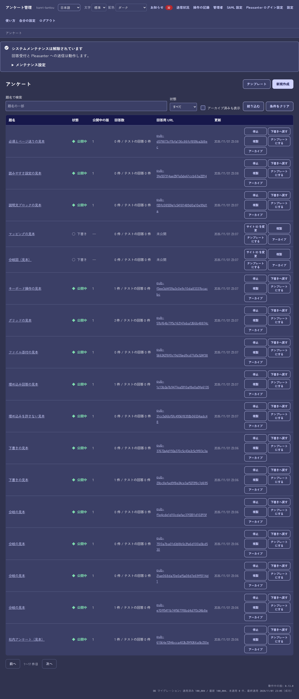

    管理画面（特大の文字）:

    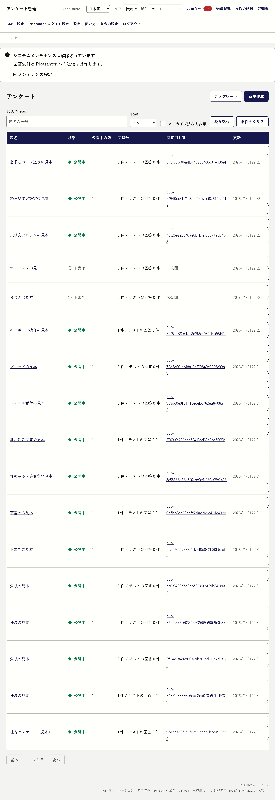
- **ヘッダ画像は本アプリが配る。** 外部の URL を貼らせない
    - **完全匿名なので、回答者のブラウザから第三者へ要求を出させない**
      （[`非機能設計.md`](非機能設計.md) 1 章）。**外部の Web フォントも読み込まない**
    - **書体はアプリに同梱する**（Issue #152）。自前配信なので第三者へ要求は出ず、
      **インターネットへ出られないイントラでも同じ見た目になる**

        | テーマの書体 | 同梱するもの |
        | --- | --- |
        | ゴシック体 | Noto Sans CJK JP（Regular・Bold。DesignReference の同梱書体。管理画面と共用） |
        | 明朝体 | Noto Serif JP Variable |
        | 丸ゴシック体 | M PLUS Rounded 1c（**可変フォントが無いので 400 と 700 だけ**） |
        | 等幅 | M PLUS 1 Code Variable（**日本語も等幅**） |

        - **unicode-range で分割された woff2。回答者が受け取るのは使った範囲だけ**
        - **ゴシック体と管理画面の書体は DesignReference 第 2.2 版の同梱書体**（Noto Sans CJK JP・Noto Sans Mono CJK JP。コード用の Myrica M は使う画面が無いので同梱しない `--without-code`。
          `Frontend/src/styles/app-fonts.css` と `src/fonts/app/`。`sync-app-fonts.mjs` で複写し、出どころは `SOURCE.json`）。
          回答画面と管理画面は**同じ woff2 を共用**する。明朝体・丸ゴシック体・等幅（M PLUS 1 Code）は作成者が選べるテーマのために維持する。
          **ライセンスは成果物の `fonts-licenses/` に入る**（`vite.config.ts` の `emitFontLicenses`）
        - **後ろに端末の書体も並べたままにする。** 配信に失敗しても文字が出なくならないため
        - ⚠️ **管理画面は明朝体と丸ゴシック体を読み込まない。**
          プレビューではその 2 つだけ端末の書体になる（本番と差が出る）
        - アイコン（Material Icons）は**管理画面だけに読み込む。**
          回答者へ配るものを重くしないため
            - 使い方は `save`。
              **中身はアイコンの名前**（リガチャで字形になる）
            - **`aria-hidden="true"` を必ず付ける。** 付けないと `save` という英単語が読み上げられる
            - **意味は文字でも書く。** アイコンだけの釦は読み上げで何も伝わらない
            - **表の中では `fixed` を足す**（`class="material-icons fixed"`）。
              箱の幅を決めて中央へ置くので、行ごとにずれない
    - 受け入れは**添付ファイルと同じ検査**（拡張子・先頭バイト・大きさ）。
      **SVG は許可しない**（中に script を書けるうえ、先頭バイトで見分けられない）
    - 出すのは**公開中の版が指している画像だけ。** 下書きで差し替えた画像は出ない
    - 説明文・完了画面の配布物も同じく、**公開中の版の記法が参照するものだけ**を
      `/api/forms/{publicId}/assets/{assetId}` から返す。保存先へリダイレクトしない
    - ⚠️ **設問・説明文で参照する画像は引換券なしで返す。**
      回答中にはまだ回答が存在しないため。完了画面からしか参照されない資産だけ、
      回答ごとの引換券を要求する
    - 配り方は「完了したときだけ」「受付終了まで」「回答から N 日（上限 365 日）」の 3 つ。
      既定は「受付終了まで」で、受付終了が無い場合は 30 日を使う。
      ⚠️ **回答から N 日は受付終了で切り詰めない**
    - ⚠️ **「完了したときだけ」は引換券を作らず、自動返信メールへリンクを載せない。**
      ダウンロード前にタブを閉じた回答者を救う手段はない。この代償を管理画面に日英で表示する
    - 引換券が期限内なら受付終了後も取得できる。アーカイブ・完全削除では取得できない
    - **配布物は必ず `Content-Disposition: attachment` で返す。**
      PDF や Office 文書を回答画面の中で開かせず、画像の `` 取得でも同じ配信口を使う

### 回答者に見せないもの

- Pleasanter の `ReferenceId`・サイト ID
- Pleasanter の URL・API のエラー本文
- **「まだ Pleasanter へ送っていない」という内部事情。**
  受付完了は受付完了として見せる

## 2. 管理アプリ

### 画面構成

| 画面 | 内容 |
| --- | --- |
| ログイン | 合言葉（ログイン ID ＋パスワード）と 2 要素。有効にしていれば「SAML」と「Pleasanter でログイン」の釦も出す（下記「ログイン画面」） |
| アンケート一覧 | 状態・本番回答数・テスト回答数・受付期間。複製・アーカイブ・復元・完全削除。**題名と状態で絞り込み、ページ送りで見る**（#79）。既定ではアーカイブ済みを隠す |
| 設問・マッピングエディタ | 左でページ・設問・選択肢と分岐を編集し、右で設問 → Pleasanter の列、変換、条件を編集する |
| プレビュー | 回答画面と同じ描画。編集画面の全幅上段にある操作から重ねて開く。「入力して確かめる」では**分岐も実際に辿れること**。「デザインを確かめる」では定義上の全ページと送信後画面を直接開き、PC・タブレット・スマホの幅で意匠を確認する。どちらも保存・送信しない |
| 分岐の全体図 | 編集画面の全幅上段にある操作から重ねて開く読み取り専用の図。ページ単位の行き先、選択肢による分岐、到達不能などの分岐の不備を確認し、ノードから該当ページの編集位置へ移動できる |
| 公開設定 | 編集画面の「公開」タブ（Issue #580）。公開 URL と QR コード、回答上限、proof-of-work の要否、端末への下書き保存、埋め込み。**保存すると公開中の回答画面へ即時に反映される**（他のタブは下書きのみ）。保存は `surveys.publish`、編集だけの人には読み取り専用。手動停止は一覧。**テスト公開までは Pleasanter サイト ID を変更できる** |
| 送信状況 | **未送信件数と最古の滞留時刻。** デッドレターの確認と手動再送。**滞留による受付停止**（#72）と**受け付けなかった添付**（#39）もここに出す |
| 管理者管理 | アカウント、役割（**5 種類**。Issue #160）、**最終ログイン日時**。追加と招待・停止と再開・**他人の 2 要素の解除**（Issue #156） |
| 自分のアカウント | **パスワードの変更**と**2 要素の登録・解除**。どちらも**パスワードの再確認つき**（Issue #156） |
| 監査ログ | 誰がいつ何を変えたか |
| お知らせ | **自動で止まったこと・届かなかったことの記録**（#80）。**未読の件数をヘッダに常に出す** |
| SAML 設定 | SAML の設定と接続の試験。`settings.saml` を持つ相手だけ |
| Pleasanter ログイン設定 | Pleasanter のログインで入る設定と接続の試験（Issue #464）。`settings.pleasanterSso` を持つ相手だけ（下記） |
| 設定 | 画面から変えられるアプリケーション設定（Issue #372）。`settings.manage` を持つ相手だけ |
| 使い方 | 管理画面の使い方 |
| メンテナンス | システム全体のメンテナンス状態の帯をヘッダの下に出す（Issue #360）。`maintenance.manage` を持つ相手はそこで切り替える。環境変数で有効にしているときは画面から外せない |

画面構成は `Frontend/src/admin/AdminApp.svelte` 488-705 行で確認した（2026-09-25）。

### 設問・ページの移動（Issue #626）

- 設問カードとページ見出しの「移動」でモーダルを開き、**入れ先を直接 1 つ選ぶ**。
  設問は全ページの先頭・各設問の前・末尾、ページは全ページの前後を候補にする。
- モーダルは `ConfirmationDialog` と同じ重ね表示の様式とし、最初の候補へフォーカスする。
  Tab / Shift+Tab はモーダル内に閉じ込め、Esc・背景・キャンセルで閉じ、開いた「移動」釦へ戻す。
- 候補を選ぶ前に、移動後の定義で**後ろ向きになるページ分岐**と**後ろの設問を参照する表示条件**を
  警告する。警告があっても選択はできるが、公開前の `SurveyFlowValidator` が最終的に拒否する。
- 移動は配列の並びだけを変える。ページ ID・設問 ID と設問への割り当ては変えず、公開済みの版も変えない。
- ページ内を回答者ごとにシャッフルする設定は、表示条件があるページでは従来どおり有効にできない。
  設問を移動して表示条件が後方参照になった場合も、候補警告と公開前検証で検出する。

| 設問を移動する | ページを移動する |
| --- | --- |
| 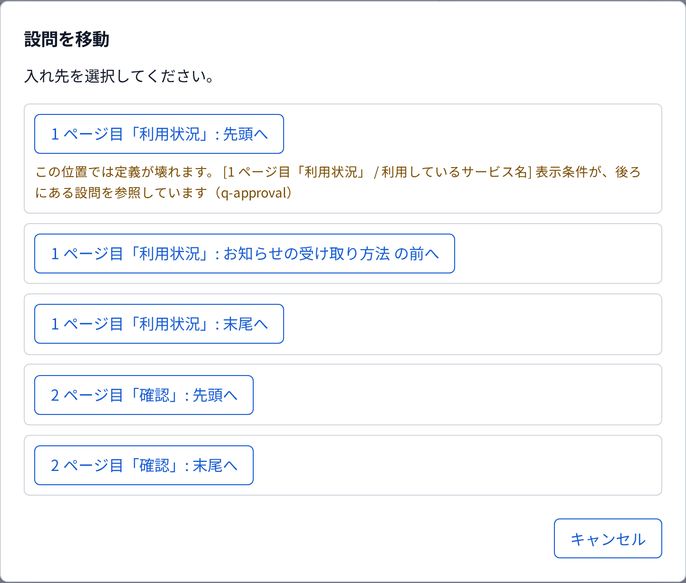 | 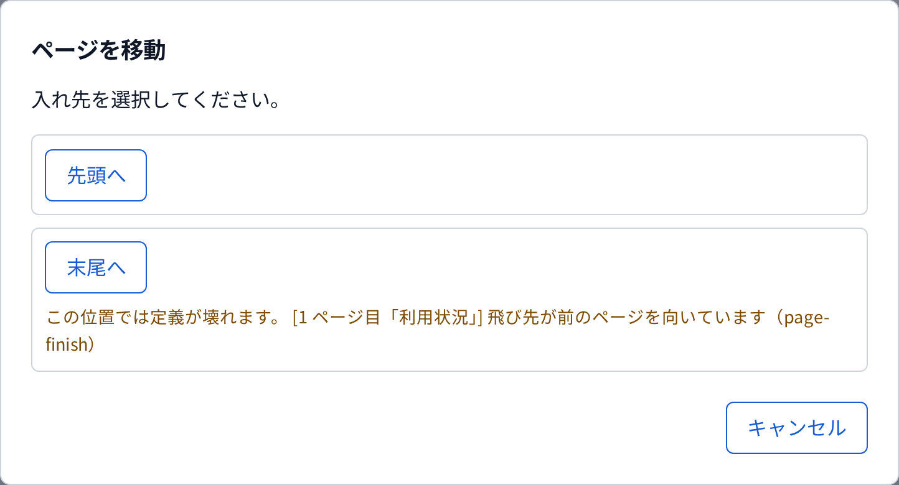 |

### ログイン画面

**合言葉のログインに加えて、有効にしている入口だけ釦を並べる。**

- 「SAML」の釦は SAML を有効にしているときだけ出す
  （[`SAML認証-運用手順書.md`](SAML認証-運用手順書.md)）
- **「Pleasanter でログイン」の釦は、Pleasanter のログインを有効にしているときだけ出す**
  （Issue #464。表示名は設定で変えられる）
    - 押すと Pleasanter のログイン画面を**別のウィンドウで開き、2 秒ごとに本人を確かめ直す。**
      Pleasanter でのログインが済めば自動で先へ進む。5 分で待つのをやめる
    - 別のウィンドウを開けなかったときは、Pleasanter のログイン画面へのリンクを出す
    - **ログイン画面を開いたとき、黙って一度だけ確かめる。** Pleasanter に既にログインしていれば、
      釦を押さずに入れる。⚠️ **自分でログアウトした直後は確かめない**
      （入り直してしまい、ログアウトできないように見える）
    - 本アプリで 2 要素を登録している管理者には、続けて 2 要素を求める。
      未登録で 2 要素が必須なら登録へ進む（SAML と同じ）
    - 未登録・停止中は理由を区別しない。締め出し中もサーバのパスワードログインと同じ文言を出す。
      初期設定待ち・接続不可などは既存の決まった文言を使う
- **最初の管理者を登録する画面には、SAML と Pleasanter の釦を出さない。**
  誰でも全権を取れてしまうため
- **SAML 失敗は共通の文言にする。** 締め出し・初期設定待ち・未登録・停止中の理由は URL に出さない。
  画面の釦を隠すだけでなく、サーバも管理者 0 人や締め出し中の認証を拒否する（共通仕様 U8）
- **SAML・Pleasanter ログイン設定の JIT 役割から `Administrator` を除外する。**
  選べるのは `Editor`・`SurveyAdministrator`・`UserAdministrator`・`Auditor`。
  ほかの管理者作成・役割変更の選択肢は変えない
- **他人の 2 要素解除は表示条件に加えてサーバでも `users.resetTwoFactor` を要求する。**
  `users.read` だけでは API を直接呼んでも 403（共通仕様 U1）
- 仕組みと前提（同じホスト名・本アプリをサブパスに置く）は
  [`Pleasanter-SSO-運用手順書.md`](Pleasanter-SSO-運用手順書.md)

U8・U1 の根拠（2026-10-23）: `Frontend/src/admin/components/SignInPanel.svelte:169-174` の失敗表示、
`SamlSettingsPanel.svelte:154-160`・`PleasanterSsoSettingsPanel.svelte:178-184` の役割選択、
`Web/Endpoints/AdminUserEndpoints.cs:222` の reset 認可。画面の実ブラウザ操作は今回未確認。

実装根拠: `Frontend/src/admin/components/SignInPanel.svelte` 99-112、195-235、361-400 行、
`Frontend/src/admin/lib/pleasanterSso.ts` 34-47 行（2026-09-25 確認）。

### Pleasanter ログイン設定（Issue #464）

ヘッダの「Pleasanter ログイン設定」から開く。**`settings.pleasanterSso` を持つ相手
（`Administrator`）だけ。**

- 項目は、有効・無効、Pleasanter の内部 URL（サーバ間）、ログイン画面とログアウト画面の URL、
  転送する cookie の名前、未登録の利用者の扱いとその場で登録するときの役割、
  確かめ直す間隔（分）、問い合わせを待つ時間（秒）、ログイン画面の釦の表示
- **外部設定で固定された項目は「設定で固定されています」と出し、画面から変えられない**
- **「接続の試験」は入力中の値で Pleasanter に問い合わせる（保存しない）。**
  同じブラウザで Pleasanter にログインしていれば、返った本人（ログイン ID・利用者 ID・
  テナント ID）と、本アプリに同じログイン ID の管理者が居るかを出す

実装根拠: `Frontend/src/admin/components/PleasanterSsoSettingsPanel.svelte`、
`Frontend/src/admin/lib/i18n/messages/ja.ts` 275-305 行（2026-09-25 確認）。
設定の置き場所は [`データモデル設計.md`](データモデル設計.md) 2.15。

### パンくずリスト（Issue #253）

管理画面の共通枠に現在地を表示する。回答画面には出さない。

- アンケートの編集では「アンケート一覧 → アンケートの編集: 題名」とし、一覧の段を押すと一覧へ戻れる
- 題名は 32 文字を超えた部分を `…` に置き換え、横に伸び続けないようにする
- 一覧と並列の管理画面（操作の記録、送信状況、お知らせ、管理者の管理、自分のアカウント）は、誤った階層を示さないため現在地だけを表示する
- 保存していないアンケート編集を離れるときは、既存の「戻る」とパンくずのどちらでも確認を出す

### 管理者管理と自分のアカウント（Issue #156）

**API だけあって画面が無い状態**を埋めたもの。とくに
**「2 要素を任意にしたのに、管理者が自分で登録できない」**（Issue #154）が解消する。

| 入口 | 見せる相手 |
| --- | --- |
| ヘッダの「管理者」 | `users.read` を持つ相手だけ |
| ヘッダの「自分の設定」 | **誰でも**（自分の設定なので役割を問わない） |

**押せない釦は出さない。**

- **自分自身は止められない・自分の役割は変えられない**（手が滑ったときに戻せない）
- **最後の Administrator は止められない・降ろせない。**
  「最後」の数え方は**有効かつ一度でもログインしたことがある人**で、
  招待を出しただけの人は数えない（サーバ側の判定と同じ）
- **自分の 2 要素は一覧から解除しない。**
  パスワードの再確認つきの「自分のアカウント」で行う
- ⚠️ **2 要素が必須の設定のときは、解除の釦を出さない**（サーバ側でも断る）

⚠️ **入口を隠すのは守りではない。** 判定はサーバ側（`AdminUserService`）にあり、
画面側（`admin/lib/adminUsers.ts`）は**同じ決まりを写したもの**。

**招待の URL はその場で 1 度だけ出す。** メールを設定していて、ログイン ID が
メールアドレスなら本人へ招待メールも送り、送れたかどうかを画面に出す（Issue #189）。
送れていなければ、出した URL を運用者が本人へ渡す。**保存しているのはハッシュのみ**なので、
画面を閉じたら出し直すしかない（`Web/Services/AdminInvitationMailer.cs` 11-26 行、
`Frontend/src/admin/components/AdminUserList.svelte` 161-169 行、2026-09-25 確認）。

**2 要素の登録はログインのときと部品を分けてある。**
ログイン時は途中状態（`Admin.Pending`）から、ここはログイン済み（`Admin.Reenroll`）から
始まり、**口も cookie も違う。** 混ぜると読めなくなるため分けた。

### お知らせ（Issue #80）

**ログを見張っていなくても気付けるようにするための画面。**
デッドレター・Pleasanter の認証失敗・滞留による受付停止・回答数の上限は、
今まで**ログにしか出ていなかった。**

- **未読の件数はヘッダに常に出す。** この画面を開くまで分からないのでは、目的を満たさない
- **件数は印だけでなく数字も出す。** 「1 件」と「300 件」は別のこと
- **同じ知らせは 1 行にまとめ、起きた回数を出す。**
  Pleasanter が壊れていれば回答は全部デッドレターになり、1 件 1 行では一覧が埋まる
- **既読は全体で 1 つ。** 誰かが気付いたら全員にとって既読
- ⚠️ **回答本文も送信元も出さない。** 出るのは「何が」「どのアンケートで」「何回」「いつ」だけ
- **`notifications.read` を持つ相手だけ**（`Administrator` / `SurveyAdministrator` / `Auditor`。
  `Web/Services/AdminPermissions.cs` 116-160 行、2026-09-25 確認）。
  どのアンケートが詰まっているかは Editor へ開く情報ではない

### アンケート一覧の絞り込みとページ送り（Issue #79）

**アンケートは消さずに溜まる**（過去の回答を解釈するために版を残す）。
全件を返して全件を描く作りは、検証環境で 1367 件になった時点で破綻した。

- **1 度に読むのは既定 50 件・上限 200 件。** 増えても開く時間が変わらない
- ⚠️ **総数は数えない。** 1 件多く読んで「次がある」だけを判断する
  （デッドレターの一覧と同じ形）
- **絞り込みは題名の部分一致と状態。** 一覧を上から眺めて探せるのは最初のうちだけ
- **アーカイブ済みは既定で除外する。** 「アーカイブ済みも表示」を選んだ場合だけ含める
- アーカイブ前の確認には、**回答受付が停止する**ことを明記する
- アーカイブ済みの行には編集・公開・停止などを出さず、**復元**を出す。
  `surveys.delete` を持つ `Administrator` には**完全削除**も出す
- **絞り込むとページは先頭へ戻す。** 3 ページ目のまま絞り込むと、
  条件に合う行があっても「1 件も無い」と見える
- **知らない状態は断る**（`400`）。黙って 0 件にすると「アンケートが消えた」と見える
- **受付数の相関副問い合わせは、返す行にだけ効かせる**（Issue #53）
- **テスト回答は本番回答と別の件数で出す。** 1 件以上なら、
  Pleasanter 側のレコードは運用側が手で削除する旨を併記する
- **テスト公開の回答用 URL には「テスト中」と出す。** URL 自体は本公開と同じで、
  認証なしで開けるため、状態を見落とさせない

### 公開状態の操作（Issue #223）

**状態遷移・各操作が使える状態・編集がどこへ効くかは
[`アンケート公開状態-フロー.md`](アンケート公開状態-フロー.md) を正本とする。**
ここへは図を複製しない。

- 回答画面はテスト公開中も開け、**「テスト公開中」と常に表示する**
- テスト回答も Pleasanter へ送るが、回答数上限と滞留監視には含めない
- サイト ID の変更は下書き・テスト公開だけに出す。送信待ちがあれば、また本番の回答が 1 件でもあればサーバが拒否する
- **本公開中・停止中でも「下書きへ戻す」を出す**（Issue #542）。回答画面が閉じるので確認を挟む

### アーカイブ（Issue #233）

アーカイブは公開状態の追加ではなく、どの公開状態にも重なる別の印として扱う。

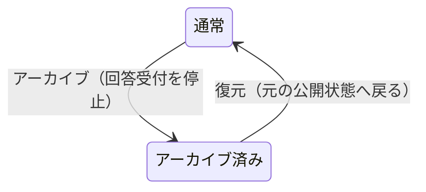

回答画面では、アーカイブ済みを存在しない公開 ID と同じ画面にする。
`Suspended` の「停止中」とは区別し、実在するアンケートだと推測できる情報を返さない。

完全削除の確認には、回答件数（本番とテストの合計）・Pleasanter サイト ID・
アーカイブ日時を表示する。併せて次を削除前に明示する。

- Pleasanter 側の回答レコードは削除されず、必要なら別途削除する
- 削除後は、残ったレコードが何のアンケートだったかを本アプリから辿れない

実行釦は題名を入力して完全一致したときだけ有効にする。サーバも同じ照合を行う。
送信待ち・送信中の回答またはメールがある場合、サーバは削除を拒否する。

実装根拠: `AdminSurveyEndpoints.cs`、`SurveyDeletionStore.cs`、`SurveyList.svelte`
（2026-09-16 確認）。

### 設問エディタで必ず出すもの

#### 設問とマッピングの配置（Issue #261、Issue #582 で別タブへ変更）

- アンケート全体の設定、テーマ、自動返信、プレビュー操作は全幅の上段へ置く。
- **設問とマッピングは別のタブ「設問」「割り当て」に分ける。** 並べて貼り付けると、
  ページ全体とマッピング側の縦スクロールが二重になるため。どちらのタブも縦のスクロールは
  ページの 1 本だけで、マッピングの表は全幅を使う。
- ページの既定の行き先と設問の選択肢による分岐は、対象の設問と同時に編集できるよう
  設問タブへ置く。
- 選択肢の行には、回答者へ表示する**任意の備考**を入力できる。備考は多言語のプレーンテキストで、
  ラジオボタン・複数選択ではラベルの下、プルダウンでは選択中の項目の下に `--muted` 色で出す。
  回答値と Pleasanter への書き込みには含めない。
- ページの「ページ下部の釦」では、「前へ」「次へ」「送信」の表示条件・有効条件と任意リンクを設定する。
  無効な釦は理由を文字で示す。
- 設問タブの各設問に割り当ての有無を出す。割り当て済みは書き込み先の列名（複数なら並べる）、
  未割り当ては目立つ表示とし、表示専用の設問には何も出さない。
  列名を押すと割り当てタブを開き、その設問を入力に含む行までスクロールして、枠、背景、
  文言で示す。
- 設問の「この設問を割り当てる」は、入力へその設問を設定し、書き込み先を空にした行を
  マッピングの末尾へ作り、割り当てタブでその行を示す。
- タブを往復しても、入力中の内容と未保存の状態は失われない（定義とマッピングは
  タブの外の状態として持つ）。
- 代わりに失ったもの: 設問を編集しながらマッピングを同時に見ること（Issue #546）。

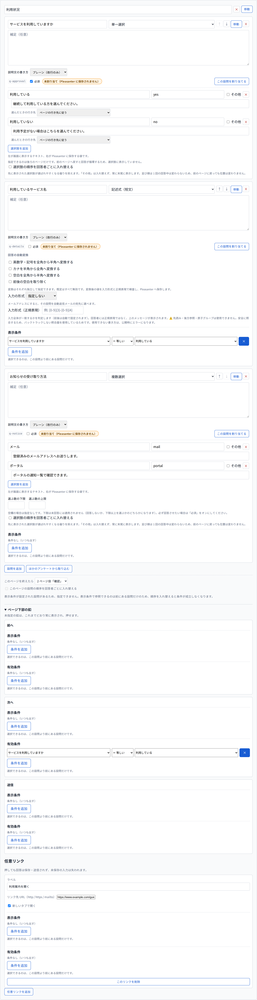

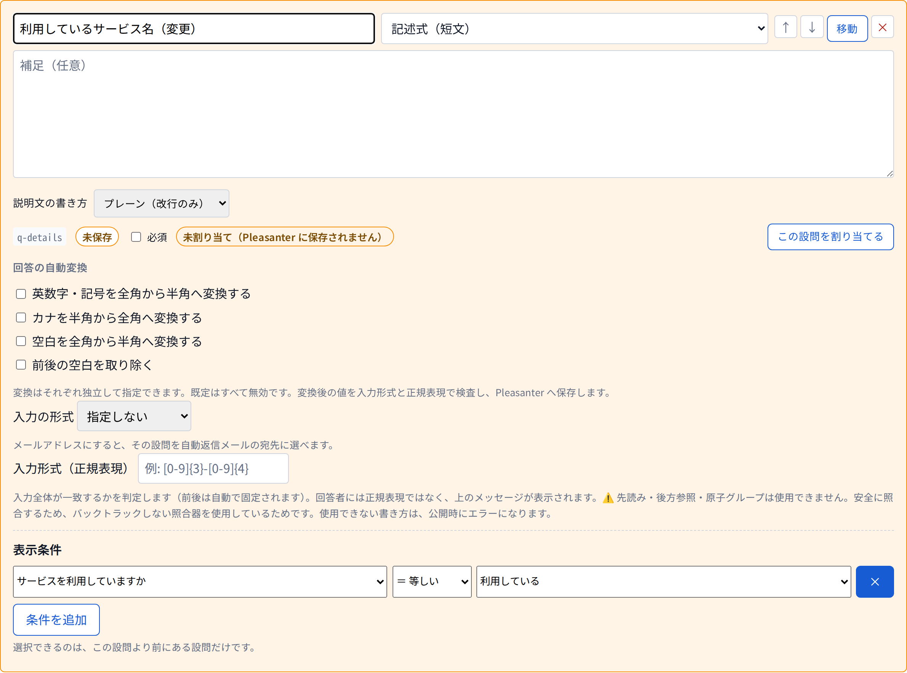

#### ほかのアンケートから設問を取り込む（Issue #358）

- 各ページの「ほかのアンケートから取り込む」では、自分が開ける下書き・公開中の
  アンケート・テンプレートから設問を複数選び、**そのページの末尾へ写す**。
  取り込み元との同期は行わず、取り込んだ時点の写しとする。
- 取り込む設問の ID はすべて付け直し、選択肢の分岐と表示条件は除去する。
  行き先のページと参照先の設問が取り込み先に無いためで、除去した件数を画面上部へ表示する。
- Pleasanter への割り当ては持ち込まず、取り込んだ設問を**未割り当て**として表示する。
  取り込み後は、グリッドとランキングの行数を含む必要列数の見積もりを直ちに計算し直す。
- 説明文の `asset:` 画像・配布リンクは資産本体を複製せず、画像の代替文またはリンクの表示文だけを
  平文で残す。資産はアンケートごとの保管領域にあり、参照だけを写すと取り込み先から取得できず、
  壊れた画像・リンクになるためである。除去した参照数も画面へ表示する。

実装根拠:
`src/VehicleVision.PleasanterTools.Questionnaire.Core/Definitions/QuestionImport.cs`、
`src/VehicleVision.PleasanterTools.Questionnaire.Web/Endpoints/AdminSurveyEndpoints.cs`、
`src/VehicleVision.PleasanterTools.Questionnaire.Frontend/src/admin/components/QuestionImportPanel.svelte`
（2026-09-21 確認）。

#### 分岐の全体図（Issue #337）

- 編集画面の全幅上段から重ねて開く。保存前の下書きを表示するが、図から定義は変更しない。
- ページを定義順に縦へ並べ、既定の行き先、ページ末尾の行き先、選択肢による行き先を
  辺として表示する。選択肢による辺には選択肢の文言を付ける。終端には送信ノードを置く。
- ノードにはページ題名、設問数、表示条件を持つ設問数を表示する。到達不能など公開を
  妨げる不備は、色だけに頼らず不備名と文言でも表示する。到達不能は
  「どこからも来られない」と明示する。
- SVG が読めない利用者にも確認できるよう、図の下にページと行き先のテキスト一覧を併記する。
  ノードを選ぶと全体図を閉じ、該当ページの編集位置へ移動する。
- 辺の種類、到達不能ページの破線枠、存在しないページへの破線の行き止まりは凡例で示す。

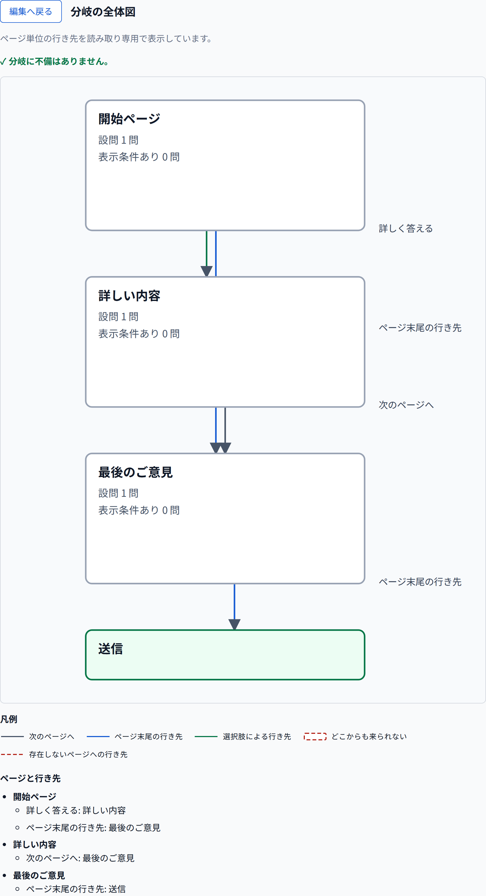

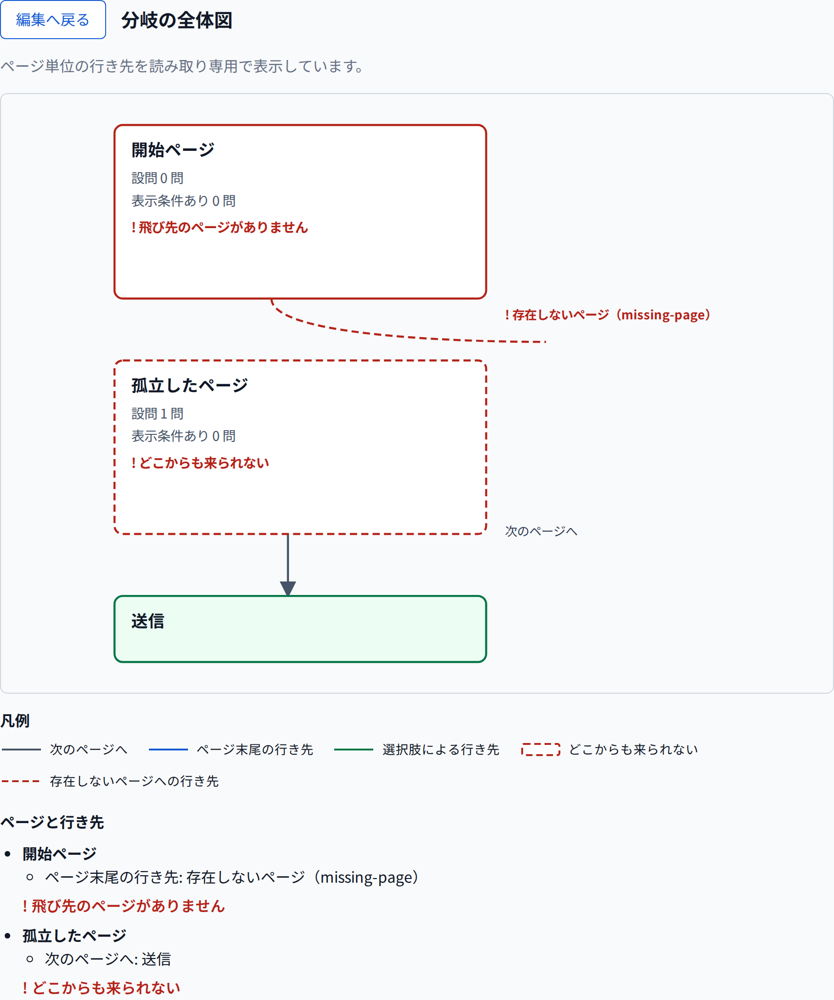

実装根拠:
`src/VehicleVision.PleasanterTools.Questionnaire.Frontend/src/admin/components/SurveyEditor.svelte`、
`SurveyFlowchart.svelte`、`QuestionEditor.svelte`、`MappingEditor.svelte`（2026-09-20 確認）。

- **残りの列数。** グリッドやランキングは 1 設問で行数ぶんの列を食う。
  **マッピング編集を開くときと「取り直す」を押したときに**、書き込み先サイトの
  `GetSite` 応答にある `SiteSettings.Columns` を接頭辞ごとに数える。
  取得できなければ標準の型ごとに 26 本で数え、どちらを基準にしているかを表示する。
- **上限を超えたら、その場で知らせる。**
  保存時に初めて失敗すると設問を作り直しになる。

    ⚠️ **止めはしない**（2026-08-20 決定）。**実際に使える本数は
    Pleasanter サイト側の項目拡張で決まる。サイトの列定義を取得できないときだけ
    標準の本数で見積もる。**
    標準の本数で止めると、列を増やしてある導入先で正しい設定を作れなくなる。
    **知らせるだけにして、判断は使う人に委ねる**
- **公開済みアンケートを編集していることの警告。**
  公開するまで実行へ影響しないことも併せて示す
- **既存の回答が読めなくなる変更**（列の割り当て変更）の警告

### ルックアップ設定（決定済み・未実装、Issue #721・#726・#728）

アンケート編集に、キー項目と参照元列、参照サイト、専用 API キー、
許可列・表示列、入力先対応、前方一致可否、最大候補件数を設定する UI を設ける。
秘密は再表示せず、接続試験は読み取りのみ。公開前に対応と権限を検証する。
既存の書き込み用マッピングとは別機能として表示する。
最初に参照元の種類（Pleasanter サイト / 日本郵便 API）を選ぶ。
以下のサイト・N 個の対応・前方一致・統合と継承の条件は Pleasanter 用とする。

設定・API キー・接続試験はアンケート管理者だけに許可する。
N 最大 5・M 最大 10、候補既定 10 件・上限 20 件。
前方一致は既定無効、キーごとに許可、文字列列だけ・最短 3 文字とする。
本文 4 KB・外部 5 秒・同時実行 4、回答者 5 分 30 回・IP 5 分 60 回・フォーム 1 分 120 回、
トークン 30 分も設定可能な初期値であり、実測で調整する（同時実行はフォームごと）。
複製時は資格情報の再登録を求め、停止・失効は再公開なしで実行時にも効かせる。
「キーを知る回答者が取得できるデータだけを許可する」警告を必ず表示し、
実機確認前・上流の K+1 件取得不可・統合や継承で範囲が広がる参照元は有効化しない。
プレビューは公開 API と別の管理経路を使い、本番から下書きを参照させない。

日本郵便は郵便番号 1 個・完全指定の固定形を表示し、前方一致を選択できない。
`client_id`・`secret_key` は入力後に暗号化し、設定済みの有無だけを表示する。
再表示・コピーを提供せず、維持・更新・解除を分ける。
運用者が設定した本番・テストの接続先を選択し、接続試験前に対象環境を明示する。
既定は本番。テスト URL は設定例だけとし、本番の資格情報をテストへ自動転送しない。
`searchtype`（事業所個別郵便番号を含む / 除く）と `choikitype`（括弧なし / あり）を選ぶ。
いずれも初期値 1。許可列・表示列・M 個の入力先は確認済みの応答列から設定する。

**利用者ごとに取得した ID が必須で、同梱・共用・第三者配布は禁止**と太字で警告する。
日本郵便で事前の組織・システム登録が必要なこと、
詳細な ID 取得手順・規約・料金・レート制限は API リファレンスに記載がなく、
利用者が日本郵便で確認することも必ず表示する。
固定のテスト用 ID は画面や設定例へ組み込まず、公式ページ参照とする。
郵便番号の外部送信と住所補完の利用目的について必須警告を表示し、導入手順へリンクする。
認証ヘッダー等の未決事項・モック試験が未完了なら日本郵便参照元を有効化しない。

操作手順・プレビュー・管理権限の決定は
[ルックアップ項目の仕様書](ルックアップ項目の仕様書.md) 8・11〜13 章を参照。

### マッピングエディタ

**「ソース → 変換 → ターゲット」の 3 列の表にする**（2026-08-20 決定。
[`アーキテクチャ方針.md`](アーキテクチャ方針.md) 15 章 決定 1）。
**実装済み**（Issue #86）。

**ノードエディタ部品は使わない。** 出力が必ず 1 本（`N:1:1` か `1:0:1`）なので、
線を引いて繋ぐ必要が無い。**1 行がそのまま 1 列への割り当てになり、表の方が読みやすく、
印刷もできる。** 外部の部品を増やさないので、ライセンスを確認する手間も無い。

| 列 | 中身 |
| --- | --- |
| ソース | 設問（＋グリッド／ランキングでは行）＋ 口（値・その他・添付の名前・添付そのもの） |
| 変換 | join / map / when など。**無し**もある |
| ターゲット | Pleasanter の列名 |

決めた点。

- **入力が複数のときは、1 つの升の中で積み、番号を振る。**
  行を分けて結合すると、変換とターゲットがどの入力群に掛かるのか読めなくなる
    - **番号は入力が複数のときだけ出す。** 1 つのときに「1.」を出しても手掛かりにならない
    - **番号の順が変換へ渡す順**（「上から順に変換へ渡します」と併記する）
- **不備はその割り当ての直下の行に出す**（変換が無いのに入力が複数、空いている添付列が無い）。
  表の外へ集めると、どの行の話か分からなくなる
- **狭い画面では横へ流す。** 畳むと 3 列の対応が読めなくなる
- **添付の行は左端に色を付けて区別する。** 変換を掛けられず、口も固定なので、
  同じ表でも扱いが違う
- **型ごとの残り列数は表の上に出したまま**（Issue #74）

出すべき情報:

- **未接続の設問。** 保存はできるが「この設問は Pleasanter に残らない」と明示する
- **型が合わない接続。** 文字列を `Num` へ繋ぐなど
- **桁溢れの見込み。** `Class` は 1024 文字

> **データモデルも同じ形で持つ**（`ColumnAssignments` / `AssignmentSources`。
> [`データモデル設計.md`](データモデル設計.md) 2.4）。**出力が 1 本に固定されているので、
> 循環参照は構造的に起こらず、検出の仕組みも持たない。**

## 3. 共通

### 表示

- **画面の文言はすべて多言語対応の器に載せる**（[`データモデル設計.md`](データモデル設計.md) 2.3）
    - **文言の持ち方・言語の決め方・鍵の抜けの見つけ方は
      [`多言語対応方針.md`](多言語対応方針.md)**
    - **回答者の言語はブラウザの中だけで決める**（URL の `?lang=` → ブラウザの言語設定 → `ja`）。
      サーバへ送らず、保存もしない
    - **管理者の言語は利用者ごとの設定**（`Core_AdminUsers.Language`）
- **アクセシビリティ。** ラベルと入力の関連付け、キーボードだけで回答できること、
  エラーの読み上げ。**公開アンケートなので回答者を選べない**
    - 文字寸法はルート要素の倍率で変え、各部品は `rem` / `em` で追随させる
    - 操作欄と管理画面ヘッダは折り返し、特大表示かつ狭い幅でも画面全体を横へ溢れさせない
    - 高コントラストとダークの本文、補足、釦、エラーなどの組み合わせは
      WCAG 2.1 AA の 4.5:1 以上を単体テストで確認する
      （`src/VehicleVision.PleasanterTools.Questionnaire.Frontend/src/lib/readability.test.ts`
      84-93 行、2026-09-20 確認）
    - 回答画面の全設問型へ Tab で表示順に到達でき、焦点の輪郭が見えること、
      ラジオを矢印キー、チェックを空白キーで選べること、キーボードだけで送信できること、
      検証エラーが `role="alert"` と入力欄の `aria-describedby` で読み上げへ伝わることを
      E2E で確認する。管理画面はログイン欄と一覧の絞り込み順、重ねて開くプレビューと
      分岐の全体図は Esc で閉じられることも確認する
      （`tools/screenshots/specs/keyboard.spec.ts`、2026-09-21 確認）

### エラーの見せ方

| 相手 | 見せ方 |
| --- | --- |
| 回答者 | **何をすればよいかを日本語で。** 内部のエラー文字列を出さない |
| 管理者 | 原因と対処。デッドレターは**どの回答か**まで辿れること |

**デッドレターの画面に回答本文を出さない**（Issue #45）。
`PayloadJson` には個人情報が入り得る（[`データモデル設計.md`](データモデル設計.md) 2.5）ので、
出すのは**失敗の理由・滞留の状況・回答トークン**まで。
本文が要る場面では、トークンを手掛かりに DB を直接見る。

### タイムゾーン

**画面の日時表示は、回答者の端末のタイムゾーンで行う。**
ただし**保存値の解釈には使わない**（[`アーキテクチャ方針.md`](アーキテクチャ方針.md) 6 章）。

**日付・数値の書式は言語に合わせる**（`Intl.DateTimeFormat` / `Intl.NumberFormat`）。
`toLocaleString('ja-JP')` のように言語を焼き付けない。
